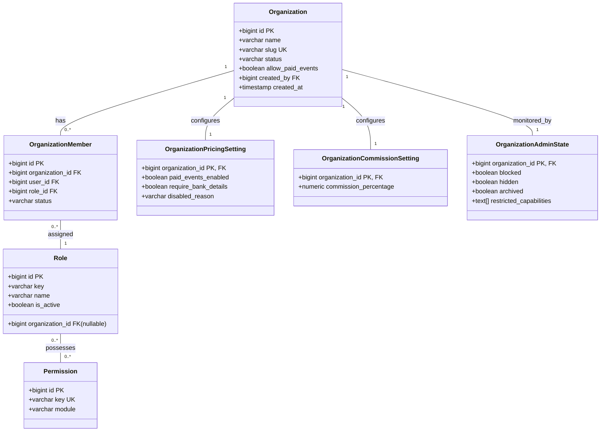
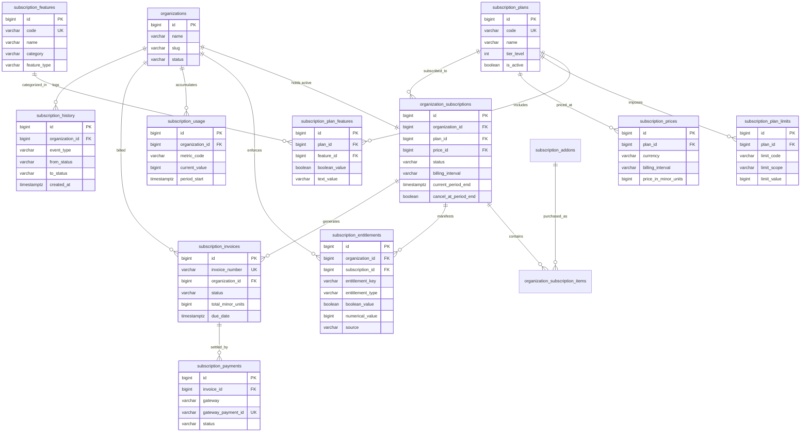
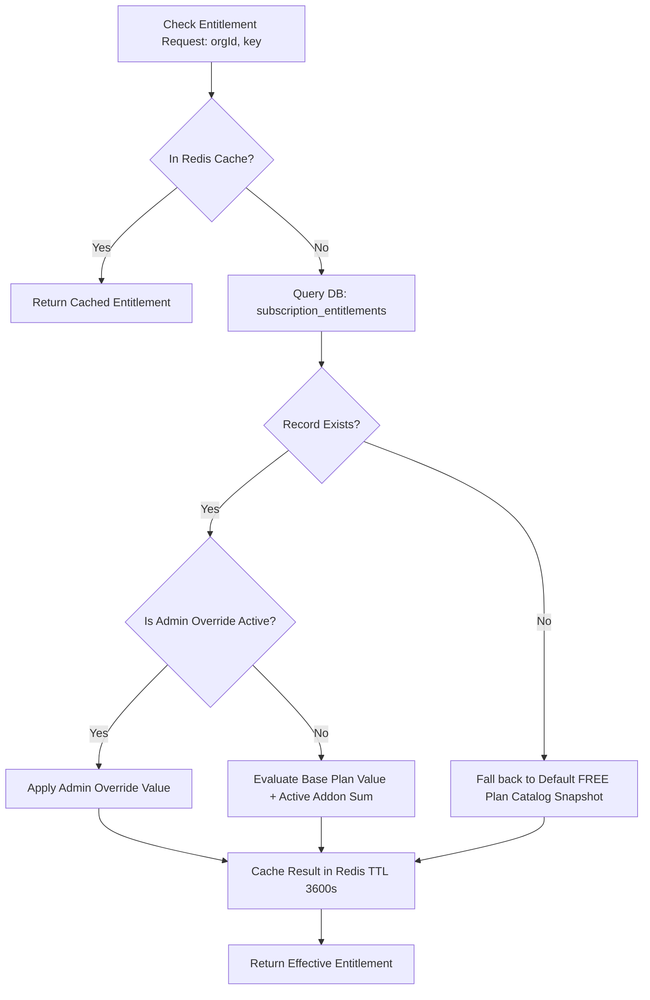
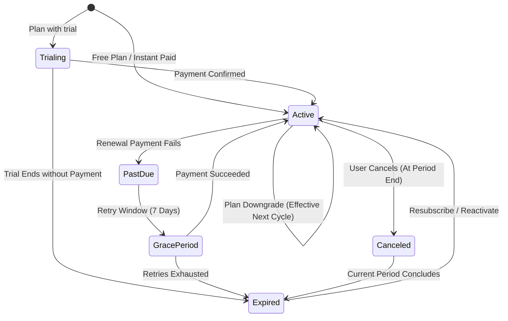
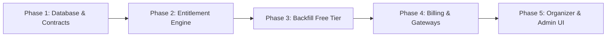

# Technical Architecture Proposal: Organization Subscription Module for Orgatick

---

## 1. Executive Summary

Orgatick is an event management and organization operations platform architected as a modular TypeScript monorepo (`apps/backend`, `apps/organizer`, `apps/admin`, `apps/client`, and shared `packages/*`). While the organization domain (onboarding, verification, member access, governance, and admin oversight) and newsletter marketing systems are fully implemented, organization monetization currently relies exclusively on per-event commission settings (`OrganizationCommissionSetting`) and paid-event feature gating (`OrganizationPricingSetting`). 

To transition Orgatick into a multi-tier SaaS model with predictable recurring revenue, this document proposes a decoupled, database-configurable **Organization Subscription Module**.

### Key Architectural Pillars:
1. **Dynamic Catalog-Driven Plans**: Four initial subscription tiers (**FREE**, **STARTER**, **PROFESSIONAL**, **ENTERPRISE**) defined purely as database records in a dedicated PostgreSQL schema (`subscription`). No plan codes or tier logic are hardcoded in application business logic.
2. **Tripartite Separation of Concerns**: Clear architectural boundary between:
   - **Catalog (What Orgatick Offers)**: Global plans, features, numerical limits, and prices.
   - **Subscription (What the Organization Purchased)**: Active billing agreement, billing interval, lifecycle state, and renewal dates.
   - **Entitlements (What the Organization Can Access Right Now)**: Materialized snapshots of boolean feature gates and numerical limits granted to an organization, immune to unexpected retrospective plan catalog mutations.
3. **Decoupled Entitlement Guarding**: Business domains (`events`, `organization-team`, `identity`, `storage`) do not query subscription or payment tables. Instead, they interact with a centralized, high-performance `EntitlementService` and declarative NestJS guards (`@RequireEntitlement()`, `@RequireLimit()`).
4. **Resilient Billing & Payment Separation**: Leverages Orgatick's pending financial specification (`payments` schema and gateway abstraction) for executing payment intents and receiving webhooks, while isolating recurring subscription lifecycle rules, proration, and subscription invoicing within the subscription domain.
5. **Non-Destructive Downgrade & Lifecycle Governance**: Organizations exceeding limits upon downgrade or expiration are governed by a **Read-Only Freeze** policy rather than destructive deletion of organizational events or members.

---

## 2. Existing Architecture Analysis

### 2.1 Monorepo Structure & Audience Split
Orgatick uses Turborepo and `pnpm` with strict unidirectional package dependencies (`apps/*` $\to$ `packages/*`, never reverse or cross-app imports):

| Application / Package | Technology Stack | Architectural Responsibility |
| :--- | :--- | :--- |
| `apps/backend` (`@orgatick/backend`) | NestJS 12, TypeORM 0.3+, PostgreSQL 16+, Redis, BullMQ | Authoritative core API, business services, database transactions, background workers |
| `apps/organizer` | Next.js 16 (App Router), Tailwind CSS, `@orgatick/ui` | Tenant console for organization operators, onboarding wizard, team/event management |
| `apps/admin` | Next.js 16 (App Router), Tailwind CSS, `@orgatick/ui` | Platform console for staff compliance, verification queues, dispute mediation |
| `apps/client` | Next.js 16 (App Router), Tailwind CSS, `@orgatick/ui` | Public event discovery, attendee registration, newsletter landing pages |
| `packages/contract` (`@orgatick/contracts`) | TypeScript, Zod | Shared wire contract schemas, DTOs, API response envelopes, pagination models |
| `packages/ui` (`@orgatick/ui`) | React, Radix UI, Tailwind CSS | Shared design system primitives (Source Sans 3, Tabler icons, tokens) |
| `packages/email` (`@orgatick/email-templates`) | React Email | Shared transactional and campaign email templates |

### 2.2 Backend Layering & Conventions (`apps/backend`)
Analysis of `apps/backend/src` and canonical guidelines reveals strict architectural conventions:
- **Strict Layering**: `HTTP Request` $\to$ `Controller` $\to$ `Zod Pipe Validation` $\to$ `Guards (Auth/Context/Permissions)` $\to$ `Domain Service` $\to$ `Repository` $\to$ `TypeORM` $\to$ `PostgreSQL`.
- **Database Multi-Schema Isolation**: Instead of a monolithic `public` schema, domain entities are partitioned into PostgreSQL schemas: `identity`, `organization`, `address`, `authorization`, `newsletter`, and the designed `payments` schema.
- **Primary & Foreign Keys**: Primary keys are uniform `BIGINT GENERATED ALWAYS AS IDENTITY` (represented as `bigint` in TypeScript and serialized as strings across network boundaries to prevent 64-bit IEEE 754 precision loss). Foreign keys strictly follow `<singular_table>_id` with relational database constraints (`ON DELETE CASCADE`, `ON DELETE SET NULL`, `ON DELETE RESTRICT`).
- **Naming Conventions**: Database tables are plural `snake_case`; columns are `snake_case`; TypeScript entities use `SnakeNamingStrategy` to map camelCase fields automatically.
- **Transactions & Concurrency**: Multi-table operations utilize `typeorm-transactional` via `@Transactional()` decorators (configured via `addTransactionalDataSource` in `orm.config.ts`). Business logic strictly performs external HTTP calls, file uploads to Cloudflare R2, and email dispatch **outside or after** database transaction commits.
- **Zod Contract-First Rule**: Entities are persistence models and are strictly prohibited from crossing network boundaries or appearing in `@orgatick/contracts`. All API requests and responses use Zod schemas and unified response envelopes (`{ success, statusCode, data, timestamp }`).

---

## 3. Existing Database Schema Analysis

A forensic audit of migrations (`apps/backend/src/database/migrations`), entity classes (`apps/backend/src/**/*.entity.ts`), and schema blueprints (`orgatick.dbml`, `payments-schema.dbml`) establishes the exact baseline of what is currently implemented versus what is planned:



### 3.1 Implemented & Migrated Domains

#### 1. Identity Subsystem (`identity` schema)
- `users`: Core actor (`id`, `name`, `email`, `normalized_email`, `role: user|admin`, timestamps).
- `user_accounts`, `user_sessions`, `user_security`, `user_verifications`, `user_devices`, `user_login_attempts`, `user_passkeys`, `user_backup_codes`.
- Handles platform-level authentication and password/passkey verification.

#### 2. Organization Subsystem (`organization` schema)
- `organizations`: Primary tenant aggregate root (`id`, `name`, `slug` [unique], `categoryId`, `subCategoryId`, `addressId`, `description`, `logo`, `email`, `phoneNumber`, `status: active|suspended|closure_requested`, `allowPaidEvents`, `createdBy`).
- `organization_members`: Relational binding between `organizations`, `identity.users`, and `authorization.roles` with unique index on `(organization_id, user_id)`.
- `organization_invitations`: Manages invite lifecycle (`PENDING`, `ACCEPTED`, `EXPIRED`, `CANCELLED`).
- `organization_stats`: Aggregate denormalized counters (`total_events`, `total_participants`, `total_paid_registrations`, `total_revenue`).
- `organization_governance`: Entities `organization_documents`, `organization_verifications`, `organization_risks`, `organization_warnings`.
- `organization_admin`: `organization_admin_state` (stores suspension, archiving, and `restricted_capabilities` array), `organization_status_history`, `organization_verification_logs`, `organization_reports`, `organization_ownership_disputes`.
- `organization_finance`:
  - `organization_bank_accounts`: KYC-verified payout account (`account_number`, `ifsc_code`, `status`).
  - `organization_payment_accounts`: Stripe/Razorpay connected merchant accounts.
  - `organization_pricing_settings`: Flags `paid_events_enabled`, `require_bank_details`.
  - `organization_commission_settings`: Platform cut on ticket sales (default `7.00%`).

#### 3. Authorization Subsystem (`authorization` schema)
- `permissions`: Global permissions catalog (`organization.*`, `event.*`, `ticket.*`, `payment.*`, `registration.*`, etc.).
- `roles`: System default roles (`organization_id IS NULL`: `owner`, `admin`, `event_manager`, `volunteer`) and custom organization-created roles (`organization_id = :orgId`).
- `role_permissions`: Many-to-many join linking roles to specific permissions.

#### 4. Shared Infrastructure
- `address` schema: `countries`, `administrative_divisions`, `cities`, `addresses`.
- `newsletter` schema: Complete campaign and subscription double-opt-in subscriber system.

### 3.2 Non-Implemented / Planned Blueprints (Verification of Reality)
- **Events & Ticketing**: Defined in `orgatick.dbml` (`events`, `event_tickets`, `registrations`, `event_sessions`, `venues`) and permission keys (`EVENT_PERMISSIONS`), but **no database migration or NestJS entity has been created yet**.
- **Payment & Wallet Subsystem**: Exhaustively designed in `payments-schema.dbml` (`payments.payment_orders`, `payments.payment_attempts`, `payments.fee_snapshots`, `payments.organization_wallets`, `payments.ledger_entries`, `payments.refunds`, `payments.settlements`, `payments.payouts`, `payments.webhook_events`, `payments.shadow_wallets`), but **no migrations exist in `apps/backend/src/database/migrations`**.
- **Subscription Domain**: Zero subscription tables, entities, or services exist anywhere in the repository.

---

## 4. Existing Components That Can Be Reused

Duplication of core mechanisms must be avoided. The table below analyzes existing platform components for direct integration into the subscription module:

| Component & Location | Current Implementation | Subscription Integration Plan | Modifications Needed | Coupling Risk Assessment |
| :--- | :--- | :--- | :--- | :--- |
| **Organization Context System**<br>`src/modules/organization/context/` | Resolves tenant context via `current_organization_id` cookie, validates active membership in DB/Redis cache, injects `@CurrentOrganization()`. | Subscription endpoints and guards rely directly on `OrganizationContextGuard` to extract authenticated tenant context. | None. Context guard and cookie handling are fully reusable. | **Low**. Natural foundational boundary; all tenant operations already require this context. |
| **RBAC Subsystem**<br>`src/common/authorization/` | Role and permission entities, `OrganizationPermissionGuard`, `@RequirePermission(...)`. Custom roles per org. | Gate subscription administration inside the tenant using new permissions: `organization.subscription.view`, `organization.subscription.manage`, `organization.billing.view`. | Add subscription permission constants to `src/common/authorization/permissions/`. | **Low**. Follows standard authorization conventions without leaking plan entitlement concepts into RBAC. |
| **Audit & History Pattern**<br>`src/modules/organization/organization-admin/` | `OrganizationStatusHistory`, `OrganizationVerificationLog` record immutable timestamped transitions with `fromStatus`, `toStatus`, `changedBy`, `actorName`. | Direct structural template for `subscription_history` table to track plan upgrades, downgrades, cancellations, and payment state changes. | None. Reuses identical architectural and schema pattern. | **None**. Pattern reuse with zero domain coupling. |
| **BullMQ Worker Queue**<br>`src/infrastructure/queue/` | Global BullModule backed by Redis (`maxmemory-policy noeviction`), connection pooling, graceful reconnection. | Register a dedicated queue (`SUBSCRIPTION_QUEUE`) to process recurring renewals, dunning cycles, grace period expiry, and billing reminders. | Add `SUBSCRIPTION_QUEUE` to `queue.constants.ts` and configure worker processor. | **Low**. Shared Redis/BullMQ infrastructure with dedicated job isolation. |
| **Redis Cache Layer**<br>`src/infrastructure/redis/` | `@nestjs/cache-manager` with Keyv and direct `ioredis` injection (`REDIS_CLIENT`). Connection pooling and error retry logic. | High-performance caching for resolved organization entitlements (`org:entitlements:{orgId}`) and plan catalogs (`subscription:plans:catalog`). | Add cache invalidation helper functions to eviction pipeline. | **Low**. Cache remains strictly an optimization layer; PostgreSQL remains source of truth. |
| **Payment Orders Specification**<br>`payments-schema.dbml` | Abstracted order lifecycle (`payment_orders`, `payment_attempts`), multi-currency minor units (paise/cents), gateway abstraction, webhook journal. | The subscription billing engine initiates payment intents via `PaymentOrderService` with `reference_type = 'subscription_invoice'`. | Wire domain event listener or coordinator service when payments module is migrated. | **Low**. Decoupled via payment references; avoids duplicating payment gateways. |
| **Cloudflare R2 Storage**<br>`src/infrastructure/storage/r2/` | S3-compatible client for storing public and private files, presigned URLs. | Storage of generated immutable subscription PDF tax invoices (`invoices/{organizationId}/{invoiceId}.pdf`). | Add PDF invoice bucket prefix configuration. | **Low**. Shared storage infrastructure; zero domain contamination. |
| **Mailer & Email Templates**<br>`packages/email`, `OrganizationNotificationMailerService` | React Email templates rendered to HTML and dispatched via BullMQ mail queue. | Provide templates for `subscription-activated`, `renewal-reminder`, `payment-failed`, and `downgrade-scheduled`. | Create new React Email components in `packages/email`. | **None**. Follows existing transactional notification architecture. |

---

## 5. Identified Architectural Gaps

1. **No Subscription Catalog or Pricing Primitives**: The database lacks any concept of recurring plans, intervals (monthly/yearly), multi-currency pricing, or add-ons.
2. **Conflation Risk Between RBAC and Entitlements**: The system currently checks *user permissions* (what a user can do inside an org). It possesses no mechanism to check *organization entitlements* (what features the organization has purchased from Orgatick).
3. **Absence of Usage Quota & Limit Tracking**: No framework exists to count, meter, or enforce resource consumption (concurrent active events, team seats, storage usage, API rate limits).
4. **Lack of Dynamic Entitlement Snapshotting**: Without historical snapshots, updating plan features in the catalog would inadvertently alter terms for existing paid subscriptions without contractual consent or renewal events.
5. **Missing Subscription Invoicing Domain**: While event ticket orders are attendee-facing transactions, organization subscriptions represent B2B recurring SaaS subscriptions with proration, distinct tax rules, billing cycles, and payment retry dunning workflows.

---

## 6. Recommended Subscription Architecture

The proposed subscription system is engineered as an independent bounded context residing within a dedicated PostgreSQL schema: `subscription`.

### High-Level Architectural Flow:

```text
HTTP Request (e.g. POST /organizations/current/events)
    │
    ▼
OrganizationContextGuard (Resolves tenant organizationId)
    │
    ▼
OrganizationPermissionGuard (Checks user RBAC: event:create)
    │
    ▼
SubscriptionEntitlementGuard (Checks tenant entitlement: feature:events)
    │
    ▼
SubscriptionLimitGuard (Checks tenant quota: limit:max_active_events)
    │
    ▼
Business Service (EventService executes business logic)
```

### Architectural Decisions:
1. **Catalog Decoupling**: Plan tiers (`FREE`, `STARTER`, `PROFESSIONAL`, `ENTERPRISE`) are database rows. New plans, custom enterprise plans, and regional prices can be created without changing code or redeploying.
2. **Immutable Entitlement Snapshots**: When an organization subscribes or renews, its effective limits and features are snapshotted into `subscription_entitlements`. Catalog changes do not break existing subscribers.
3. **Additive Add-ons Architecture**: Add-ons (`subscription_addons`) increase limits or grant additional features additively onto the base plan snapshot.
4. **Read-Only Degradation**: Downgrading or expiration triggers resource access freezes rather than record deletions.

---

## 7. Complete Proposed Database Tables

Thirteen tables across five cohesive architectural groups are proposed for the `subscription` schema:

```text
subscription/
├── Catalog
│   ├── subscription_plans                (Base plan definition & hierarchy)
│   ├── subscription_features             (Master feature dictionary)
│   ├── subscription_plan_features        (Plan-to-feature matrix)
│   ├── subscription_plan_limits          (Numerical limits per plan)
│   ├── subscription_prices               (Multi-currency & interval pricing)
│   └── subscription_addons               (Purchasable add-on catalog)
├── Organization Subscriptions
│   ├── organization_subscriptions        (Current organization subscription state)
│   ├── subscription_entitlements         (Materialized active entitlement snapshot)
│   ├── organization_subscription_items   (Attached base plans & active add-ons)
│   └── subscription_history              (Immutable audit trail of all lifecycle events)
├── Usage Management
│   └── subscription_usage                (Period-based and continuous metric counters)
└── Billing & Payments
    ├── subscription_invoices             (B2B recurring tax invoices & proration)
    └── subscription_payments             (Payment attempts & gateway transaction linkage)
```

---

## 8. Detailed Table Columns and Constraints

### 8.1 Catalog Tables

#### 1. `subscription.subscription_plans`
Defines available subscription plans.
- `id`: `BIGINT GENERATED ALWAYS AS IDENTITY PRIMARY KEY`
- `code`: `VARCHAR(50) NOT NULL UNIQUE` (e.g. `'free'`, `'starter'`, `'professional'`, `'enterprise'`)
- `name`: `VARCHAR(100) NOT NULL` (e.g. `'Professional Plan'`)
- `description`: `TEXT NULL`
- `tier_level`: `INT NOT NULL` (Hierarchical ordinal: Free=0, Starter=10, Pro=20, Enterprise=30; used to determine upgrade vs downgrade)
- `is_active`: `BOOLEAN NOT NULL DEFAULT true` (Whether new subscriptions can select this plan)
- `is_public`: `BOOLEAN NOT NULL DEFAULT true` (Public in pricing UI vs private/custom enterprise)
- `trial_period_days`: `INT NOT NULL DEFAULT 0`
- `sort_order`: `INT NOT NULL DEFAULT 0`
- `created_at`: `TIMESTAMPTZ NOT NULL DEFAULT now()`
- `updated_at`: `TIMESTAMPTZ NOT NULL DEFAULT now()`
- *Indexes*: `(is_active, is_public)`, `(tier_level)`

#### 2. `subscription.subscription_features`
Catalog of discrete functional capabilities Orgatick can gate.
- `id`: `BIGINT GENERATED ALWAYS AS IDENTITY PRIMARY KEY`
- `code`: `VARCHAR(100) NOT NULL UNIQUE` (e.g. `'custom_branding'`, `'advanced_analytics'`, `'api_access'`, `'webhooks'`, `'custom_domain'`, `'audit_logs'`, `'custom_roles'`)
- `name`: `VARCHAR(150) NOT NULL`
- `description`: `TEXT NULL`
- `category`: `VARCHAR(50) NOT NULL` (e.g. `'branding'`, `'analytics'`, `'governance'`, `'developer'`, `'events'`)
- `feature_type`: `VARCHAR(30) NOT NULL DEFAULT 'boolean'` (`'boolean'`, `'tier_level'`)
- `is_active`: `BOOLEAN NOT NULL DEFAULT true`
- `created_at`: `TIMESTAMPTZ NOT NULL DEFAULT now()`
- `updated_at`: `TIMESTAMPTZ NOT NULL DEFAULT now()`
- *Indexes*: `(category, is_active)`

#### 3. `subscription.subscription_plan_features`
Mapping between plans and supported feature levels.
- `id`: `BIGINT GENERATED ALWAYS AS IDENTITY PRIMARY KEY`
- `plan_id`: `BIGINT NOT NULL REFERENCES subscription.subscription_plans(id) ON DELETE CASCADE`
- `feature_id`: `BIGINT NOT NULL REFERENCES subscription.subscription_features(id) ON DELETE CASCADE`
- `value_type`: `VARCHAR(30) NOT NULL DEFAULT 'boolean'` (`'boolean'`, `'text_tier'`)
- `boolean_value`: `BOOLEAN NOT NULL DEFAULT false`
- `text_value`: `VARCHAR(100) NULL` (e.g. `'basic'`, `'advanced'`, `'custom'`)
- `created_at`: `TIMESTAMPTZ NOT NULL DEFAULT now()`
- `updated_at`: `TIMESTAMPTZ NOT NULL DEFAULT now()`
- *Constraints*: `UNIQUE (plan_id, feature_id)`

#### 4. `subscription.subscription_plan_limits`
Numerical capacity quotas configured for a plan.
- `id`: `BIGINT GENERATED ALWAYS AS IDENTITY PRIMARY KEY`
- `plan_id`: `BIGINT NOT NULL REFERENCES subscription.subscription_plans(id) ON DELETE CASCADE`
- `limit_code`: `VARCHAR(100) NOT NULL` (e.g. `'max_active_events'`, `'max_team_members'`, `'max_org_admins'`, `'max_event_managers'`, `'max_storage_bytes'`, `'max_custom_roles'`, `'max_monthly_api_requests'`, `'analytics_retention_days'`)
- `limit_scope`: `VARCHAR(30) NOT NULL` (`'concurrent'`, `'total'`, `'monthly_quota'`, `'retention_days'`)
- `limit_value`: `BIGINT NOT NULL` (Numerical limit; `-1` represents unlimited)
- `created_at`: `TIMESTAMPTZ NOT NULL DEFAULT now()`
- `updated_at`: `TIMESTAMPTZ NOT NULL DEFAULT now()`
- *Constraints*: `UNIQUE (plan_id, limit_code)`

#### 5. `subscription.subscription_prices`
Recurring pricing options per plan across intervals and currencies.
- `id`: `BIGINT GENERATED ALWAYS AS IDENTITY PRIMARY KEY`
- `plan_id`: `BIGINT NOT NULL REFERENCES subscription.subscription_plans(id) ON DELETE CASCADE`
- `currency`: `VARCHAR(3) NOT NULL DEFAULT 'INR'` (ISO 4217 Currency Code)
- `billing_interval`: `VARCHAR(20) NOT NULL` (`'month'`, `'year'`)
- `price_in_minor_units`: `BIGINT NOT NULL DEFAULT 0` (e.g. ₹1,999/mo = `199900` paise)
- `is_active`: `BOOLEAN NOT NULL DEFAULT true`
- `created_at`: `TIMESTAMPTZ NOT NULL DEFAULT now()`
- `updated_at`: `TIMESTAMPTZ NOT NULL DEFAULT now()`
- *Constraints*: `UNIQUE (plan_id, currency, billing_interval)`

#### 6. `subscription.subscription_addons`
Catalog of purchasable add-on packs.
- `id`: `BIGINT GENERATED ALWAYS AS IDENTITY PRIMARY KEY`
- `code`: `VARCHAR(100) NOT NULL UNIQUE` (e.g. `'addon_storage_50gb'`, `'addon_team_5_seats'`, `'addon_custom_domain'`)
- `name`: `VARCHAR(150) NOT NULL`
- `description`: `TEXT NULL`
- `addon_type`: `VARCHAR(30) NOT NULL` (`'quota_increase'`, `'feature_unlock'`)
- `target_code`: `VARCHAR(100) NOT NULL` (Target `feature_code` or `limit_code`)
- `granted_value`: `BIGINT NOT NULL DEFAULT 0` (e.g. `53687091200` for 50GB storage, `5` for seats, `1` for boolean unlock)
- `price_in_minor_units`: `BIGINT NOT NULL`
- `currency`: `VARCHAR(3) NOT NULL DEFAULT 'INR'`
- `billing_interval`: `VARCHAR(20) NOT NULL DEFAULT 'month'`
- `is_active`: `BOOLEAN NOT NULL DEFAULT true`
- `created_at`: `TIMESTAMPTZ NOT NULL DEFAULT now()`
- `updated_at`: `TIMESTAMPTZ NOT NULL DEFAULT now()`

---

### 8.2 Organization Subscription & Entitlement Tables

#### 7. `subscription.organization_subscriptions`
The single authoritative active subscription state for an organization.
- `id`: `BIGINT GENERATED ALWAYS AS IDENTITY PRIMARY KEY`
- `organization_id`: `BIGINT NOT NULL REFERENCES organization.organizations(id) ON DELETE RESTRICT`
- `plan_id`: `BIGINT NOT NULL REFERENCES subscription.subscription_plans(id) ON DELETE RESTRICT`
- `price_id`: `BIGINT NULL REFERENCES subscription.subscription_prices(id) ON DELETE RESTRICT` (null for Free plan)
- `status`: `VARCHAR(30) NOT NULL DEFAULT 'active'` (`'trialing'`, `'active'`, `'past_due'`, `'grace_period'`, `'paused'`, `'canceled'`, `'expired'`)
- `billing_interval`: `VARCHAR(20) NOT NULL DEFAULT 'month'` (`'month'`, `'year'`, `'none'`)
- `currency`: `VARCHAR(3) NOT NULL DEFAULT 'INR'`
- `current_period_start`: `TIMESTAMPTZ NOT NULL`
- `current_period_end`: `TIMESTAMPTZ NOT NULL`
- `trial_start`: `TIMESTAMPTZ NULL`
- `trial_end`: `TIMESTAMPTZ NULL`
- `grace_period_end`: `TIMESTAMPTZ NULL`
- `cancel_at_period_end`: `BOOLEAN NOT NULL DEFAULT false`
- `canceled_at`: `TIMESTAMPTZ NULL`
- `cancellation_reason`: `VARCHAR(500) NULL`
- `pending_plan_id`: `BIGINT NULL REFERENCES subscription.subscription_plans(id)` (For scheduled downgrades at period end)
- `pending_price_id`: `BIGINT NULL REFERENCES subscription.subscription_prices(id)`
- `auto_renew`: `BOOLEAN NOT NULL DEFAULT true`
- `version`: `INT NOT NULL DEFAULT 1` (Optimistic concurrency counter)
- `created_at`: `TIMESTAMPTZ NOT NULL DEFAULT now()`
- `updated_at`: `TIMESTAMPTZ NOT NULL DEFAULT now()`
- *Constraints*: `UNIQUE (organization_id)` (One active subscription record per organization)
- *Indexes*: `(status, current_period_end)`, `(status, grace_period_end)`

#### 8. `subscription.subscription_entitlements`
Materialized, snapshotted entitlements governing the organization.
- `id`: `BIGINT GENERATED ALWAYS AS IDENTITY PRIMARY KEY`
- `organization_id`: `BIGINT NOT NULL REFERENCES organization.organizations(id) ON DELETE CASCADE`
- `subscription_id`: `BIGINT NOT NULL REFERENCES subscription.organization_subscriptions(id) ON DELETE CASCADE`
- `entitlement_key`: `VARCHAR(100) NOT NULL` (e.g. `'feature:custom_branding'`, `'limit:max_active_events'`)
- `entitlement_type`: `VARCHAR(30) NOT NULL` (`'boolean'`, `'numerical_limit'`, `'text_tier'`)
- `boolean_value`: `BOOLEAN NOT NULL DEFAULT false`
- `numerical_value`: `BIGINT NOT NULL DEFAULT 0` (`-1` = unlimited)
- `text_value`: `VARCHAR(100) NULL`
- `is_unlimited`: `BOOLEAN NOT NULL DEFAULT false`
- `source`: `VARCHAR(30) NOT NULL DEFAULT 'plan'` (`'plan'`, `'addon'`, `'admin_override'`)
- `override_reason`: `VARCHAR(500) NULL`
- `overridden_by`: `BIGINT NULL REFERENCES identity.users(id)`
- `valid_from`: `TIMESTAMPTZ NOT NULL DEFAULT now()`
- `valid_until`: `TIMESTAMPTZ NULL`
- `created_at`: `TIMESTAMPTZ NOT NULL DEFAULT now()`
- `updated_at`: `TIMESTAMPTZ NOT NULL DEFAULT now()`
- *Constraints*: `UNIQUE (organization_id, entitlement_key)`
- *Indexes*: `(organization_id, entitlement_key)`

#### 9. `subscription.organization_subscription_items`
Purchased items composing the active subscription (base plan + add-ons).
- `id`: `BIGINT GENERATED ALWAYS AS IDENTITY PRIMARY KEY`
- `subscription_id`: `BIGINT NOT NULL REFERENCES subscription.organization_subscriptions(id) ON DELETE CASCADE`
- `item_type`: `VARCHAR(30) NOT NULL` (`'plan'`, `'addon'`)
- `plan_id`: `BIGINT NULL REFERENCES subscription.subscription_plans(id) ON DELETE RESTRICT`
- `addon_id`: `BIGINT NULL REFERENCES subscription.subscription_addons(id) ON DELETE RESTRICT`
- `quantity`: `INT NOT NULL DEFAULT 1`
- `unit_price_minor_units`: `BIGINT NOT NULL DEFAULT 0`
- `currency`: `VARCHAR(3) NOT NULL DEFAULT 'INR'`
- `is_active`: `BOOLEAN NOT NULL DEFAULT true`
- `started_at`: `TIMESTAMPTZ NOT NULL DEFAULT now()`
- `ended_at`: `TIMESTAMPTZ NULL`
- `created_at`: `TIMESTAMPTZ NOT NULL DEFAULT now()`
- `updated_at`: `TIMESTAMPTZ NOT NULL DEFAULT now()`
- *Indexes*: `(subscription_id, is_active)`

#### 10. `subscription.subscription_history`
Immutable chronological audit log of all subscription and billing events.
- `id`: `BIGINT GENERATED ALWAYS AS IDENTITY PRIMARY KEY`
- `organization_id`: `BIGINT NOT NULL REFERENCES organization.organizations(id) ON DELETE CASCADE`
- `subscription_id`: `BIGINT NOT NULL`
- `event_type`: `VARCHAR(50) NOT NULL` (`'created'`, `'renewed'`, `'plan_upgraded'`, `'plan_downgraded'`, `'downgrade_scheduled'`, `'canceled'`, `'expired'`, `'grace_period_entered'`, `'payment_failed'`, `'addon_added'`, `'addon_removed'`, `'admin_override_granted'`)
- `from_plan_id`: `BIGINT NULL REFERENCES subscription.subscription_plans(id)`
- `to_plan_id`: `BIGINT NULL REFERENCES subscription.subscription_plans(id)`
- `from_status`: `VARCHAR(30) NULL`
- `to_status`: `VARCHAR(30) NULL`
- `reason`: `VARCHAR(500) NULL`
- `metadata`: `JSONB NULL` (Snapshot of prorated amounts, plan names, or IP context)
- `actor_type`: `VARCHAR(30) NOT NULL DEFAULT 'system'` (`'user'`, `'admin'`, `'system'`, `'webhook'`)
- `actor_id`: `BIGINT NULL REFERENCES identity.users(id)`
- `actor_name`: `VARCHAR(255) NULL`
- `created_at`: `TIMESTAMPTZ NOT NULL DEFAULT now()`
- *Indexes*: `(organization_id, created_at)`, `(event_type)`

---

### 8.3 Usage Management Tables

#### 11. `subscription.subscription_usage`
Current resource consumption per organization metric.
- `id`: `BIGINT GENERATED ALWAYS AS IDENTITY PRIMARY KEY`
- `organization_id`: `BIGINT NOT NULL REFERENCES organization.organizations(id) ON DELETE CASCADE`
- `metric_code`: `VARCHAR(100) NOT NULL` (`'active_events'`, `'team_members'`, `'storage_bytes'`, `'custom_roles'`, `'monthly_api_requests'`)
- `usage_scope`: `VARCHAR(30) NOT NULL` (`'concurrent'`, `'total'`, `'monthly_quota'`)
- `current_value`: `BIGINT NOT NULL DEFAULT 0`
- `period_start`: `TIMESTAMPTZ NULL` (Set for monthly rolling quotas; null for continuous counts)
- `period_end`: `TIMESTAMPTZ NULL`
- `last_recalculated_at`: `TIMESTAMPTZ NOT NULL DEFAULT now()`
- `updated_at`: `TIMESTAMPTZ NOT NULL DEFAULT now()`
- *Constraints*: `UNIQUE (organization_id, metric_code, period_start)`
- *Indexes*: `(organization_id, metric_code)`

---

### 8.4 Billing & Payment Tables

#### 12. `subscription.subscription_invoices`
Formal tax and renewal invoices issued to organizations.
- `id`: `BIGINT GENERATED ALWAYS AS IDENTITY PRIMARY KEY`
- `public_id`: `VARCHAR(36) NOT NULL UNIQUE` (External ULID/UUID for public reference)
- `invoice_number`: `VARCHAR(100) NOT NULL UNIQUE` (Sequential, e.g. `'INV-SUB-2026-00042'`)
- `organization_id`: `BIGINT NOT NULL REFERENCES organization.organizations(id) ON DELETE RESTRICT`
- `subscription_id`: `BIGINT NOT NULL REFERENCES subscription.organization_subscriptions(id) ON DELETE RESTRICT`
- `billing_reason`: `VARCHAR(50) NOT NULL` (`'subscription_cycle'`, `'subscription_create'`, `'subscription_upgrade'`, `'addon_purchase'`)
- `status`: `VARCHAR(30) NOT NULL DEFAULT 'draft'` (`'draft'`, `'open'`, `'paid'`, `'uncollectible'`, `'void'`)
- `currency`: `VARCHAR(3) NOT NULL DEFAULT 'INR'`
- `subtotal_minor_units`: `BIGINT NOT NULL DEFAULT 0`
- `tax_rate_bps`: `INT NOT NULL DEFAULT 1800` (18.00% GST)
- `tax_amount_minor_units`: `BIGINT NOT NULL DEFAULT 0`
- `total_minor_units`: `BIGINT NOT NULL DEFAULT 0`
- `proration_credit_minor_units`: `BIGINT NOT NULL DEFAULT 0`
- `period_start`: `TIMESTAMPTZ NOT NULL`
- `period_end`: `TIMESTAMPTZ NOT NULL`
- `due_date`: `TIMESTAMPTZ NOT NULL`
- `paid_at`: `TIMESTAMPTZ NULL`
- `pdf_url`: `VARCHAR(1000) NULL` (Cloudflare R2 stored PDF)
- `created_at`: `TIMESTAMPTZ NOT NULL DEFAULT now()`
- `updated_at`: `TIMESTAMPTZ NOT NULL DEFAULT now()`
- *Indexes*: `(organization_id, status)`, `(due_date, status)`

#### 13. `subscription.subscription_payments`
Payment transactions attempting to settle subscription invoices.
- `id`: `BIGINT GENERATED ALWAYS AS IDENTITY PRIMARY KEY`
- `invoice_id`: `BIGINT NOT NULL REFERENCES subscription.subscription_invoices(id) ON DELETE RESTRICT`
- `organization_id`: `BIGINT NOT NULL REFERENCES organization.organizations(id) ON DELETE RESTRICT`
- `payment_order_id`: `BIGINT NULL` (Foreign reference to `payments.payment_orders.id` in payments subsystem)
- `gateway`: `VARCHAR(50) NOT NULL DEFAULT 'razorpay'` (`'razorpay'`, `'stripe'`, `'offline'`)
- `gateway_order_id`: `VARCHAR(255) NULL`
- `gateway_payment_id`: `VARCHAR(255) NULL UNIQUE`
- `amount_minor_units`: `BIGINT NOT NULL`
- `currency`: `VARCHAR(3) NOT NULL DEFAULT 'INR'`
- `status`: `VARCHAR(30) NOT NULL DEFAULT 'pending'` (`'pending'`, `'authorized'`, `'captured'`, `'failed'`, `'refunded'`)
- `error_code`: `VARCHAR(100) NULL`
- `error_description`: `TEXT NULL`
- `idempotency_key`: `VARCHAR(255) NOT NULL UNIQUE`
- `created_at`: `TIMESTAMPTZ NOT NULL DEFAULT now()`
- `updated_at`: `TIMESTAMPTZ NOT NULL DEFAULT now()`
- *Indexes*: `(invoice_id, status)`, `(gateway_payment_id)`

---

## 9. Entity Relationship Diagram (Mermaid)



---

## 10. Subscription Feature and Limit Model

### 10.1 Dimension Classification
Limits operate on four distinct behavioral models:

1. **Concurrent Limits (`concurrent`)**: Maximum simultaneous active resources.
   - Example: `max_active_events` (Events with status `published`, `scheduled`, or `live`). Once an event transitions to `completed` or `cancelled`, capacity is immediately liberated.
2. **Total Accumulated Limits (`total`)**: Cumulative resources provisioned under the organization.
   - Example: `max_team_members` (Active users in `organization_members`), `max_custom_roles` (Active rows in `roles` with `organization_id = :orgId`), `max_storage_bytes` (Total bytes uploaded to R2).
3. **Period-Based Quotas (`monthly_quota`)**: Resets automatically at the start of each billing cycle or calendar month.
   - Example: `max_monthly_api_requests` (Public API gateway calls).
4. **Data Retention Windows (`retention_days`)**: Time-series query cutoff.
   - Example: `analytics_retention_days` (Filters time window on analytics queries: 30 days for Starter, 365 days for Pro, unlimited for Enterprise).

---

## 11. Organization Entitlement Resolution

### 11.1 The Entitlement Resolution Pipeline
When an application service or guard checks if an organization is entitled to a feature or has remaining capacity, it queries the `EntitlementService`. The resolution algorithm evaluates three hierarchical layers:



### 11.2 Grandfathering & Catalog Immutability
- **The Problem**: If Orgatick reduces the Free plan limit from 3 events to 1 event, organizations currently running 2 events must not be broken instantly.
- **The Solution**: Plans define the *offer*; `subscription_entitlements` defines the *contract*. When an organization subscribes, their entitlements are snapshotted in `subscription_entitlements`. Catalog modifications update future subscriptions or take effect upon explicit renewal migration jobs.
- **Add-on Stacking**: If a plan allows 5 active events and the organization purchases an `addon_active_events_2` pack, the entitlement updater increments `subscription_entitlements.numerical_value` by `2` and records `source = 'addon'`.

---

## 12. Recommended Plan Distribution

Features are mapped against real platform capabilities verified from the codebase:

| Feature / Limit Key | Metric Type | Free | Starter | Professional | Enterprise | Codebase Implementation Status |
| :--- | :--- | :--- | :--- | :--- | :--- | :--- |
| **Organization Management** | Boolean | Yes | Yes | Yes | Yes | **Implemented** (`OrganizationModule`) |
| **Organization Verification** | Boolean | Yes | Yes | Yes | Yes | **Implemented** (`OrganizationGovernanceModule`) |
| **Team Management** | Concurrent | Up to 2 seats | Up to 5 seats | Up to 15 seats | Unlimited (-1) | **Implemented** (`OrganizationMemberModule`) |
| **System Roles** (`Owner`, `Admin`, etc.) | Boolean | Yes | Yes | Yes | Yes | **Implemented** (`default-roles.ts`) |
| **Custom Roles Creation** | Total Limit | 0 (No) | 0 (No) | Up to 10 | Unlimited (-1) | **Implemented in DB schema** (`authorization.roles.organization_id`) |
| **Maximum Active Events** | Concurrent | 1 active | Up to 3 active | Up to 10 active | Unlimited (-1) | **Specified** (`orgatick.dbml`; module pending) |
| **Ticket Template Editor** | Boolean | Basic | Basic | Advanced | Advanced | **Implemented** (`apps/organizer/.../ticket-templates`) |
| **Organization Storage** | Total Limit | 1 GB | 10 GB | 50 GB | 500 GB+ | **Implemented** (`R2Storage` service active) |
| **Platform Commission on Paid Tickets** | Pricing % | 7.00% | 5.50% | 3.50% | Negotiated / 2.00% | **Implemented** (`OrganizationCommissionSetting`) |
| **Custom Branding / White-label** | Text Tier | None | Basic (Logo/Cover) | Full (Custom Colors) | White-label / Removal of "Powered by Orgatick" | **Partially Implemented** (Logo/cover implemented; CSS theme pending) |
| **Public API Access** | Monthly Quota | 0 (No) | 0 (No) | 50,000 req/mo | Unlimited (-1) | **Proposed Future Feature** |
| **Webhooks** | Boolean | No | No | Up to 3 endpoints | Unlimited endpoints | **Proposed Future Feature** |
| **Audit Logs Export** | Retention | None | 7 days | 90 days | 365+ days | **Partially Implemented** (`organization-status-history`) |
| **Custom Domain** (`events.org.com`) | Boolean | No | No | No | Yes (SSL included) | **Proposed Future Feature** |

---

## 13. Usage Tracking Architecture

### 13.1 Concurrency & Race-Condition Safe Limit Enforcement
A critical failure mode in SaaS platforms is concurrent requests exploiting non-atomic limit checks (e.g., two admins simultaneously inviting team members when only 1 seat remains).

#### Non-Negotiable Concurrency Policy:
1. **Never use Redis as the authoritative check for critical state creation**: A Redis counter increment (`INCR`) followed by asynchronous DB write can drift if DB rollbacks occur.
2. **Database Row-Level Advisory Locking for Concurrent State Checks**:
   When an organization creates a resource governed by a concurrent limit (e.g. creating/publishing an event, inviting a team member), the operation executes within a transaction with a deterministic PostgreSQL transaction advisory lock scoped to `(organization_id, metric_code)`:

```typescript
// Conceptual Atomic Capacity Guard in Service
await this.dataSource.transaction(async (manager) => {
  // 1. Acquire transaction-scoped advisory lock on the org's resource metric
  const lockKey = generateMetricLockHash(organizationId, 'max_team_members');
  await manager.query(`SELECT pg_advisory_xact_lock($1)`, [lockKey]);

  // 2. Fetch authoritative effective limit from snapshot
  const entitlement = await manager.findOne(SubscriptionEntitlement, {
    where: { organizationId, entitlementKey: 'limit:max_team_members' }
  });
  const maxAllowed = entitlement.numericalValue;

  // 3. Count current active records directly in DB
  const currentCount = await manager.count(OrganizationMember, {
    where: { organizationId, status: OrganizationMemberStatus.ACTIVE }
  });

  if (maxAllowed !== -1 && currentCount >= maxAllowed) {
    throw new QuotaExceededException('Team member limit reached for your plan. Please upgrade.');
  }

  // 4. Safe to insert new record
  await manager.save(OrganizationMember, newMember);
});
```

### 13.2 Usage Tracking Table Maintenance
- Continuous metrics (`active_events`, `team_members`, `storage_bytes`) update their cached record in `subscription.subscription_usage` via TypeORM entity subscribers (`afterInsert`, `afterUpdate`, `afterRemove`).
- Period metrics (e.g. `monthly_api_requests`) increment atomic counters in Redis and flush aggregated deltas to `subscription.subscription_usage` every 15 minutes via BullMQ.

---

## 14. Billing and Payment Integration

### 14.1 Boundary: Subscription vs Payment Subsystem
The subscription module must **not** duplicate payment gateway drivers. It coordinates with the payment subsystem (`payments-schema.dbml`):

```text
┌────────────────────────────────────────┐
│          Subscription Module           │
│  - Plans, Intervals, Add-ons           │
│  - Proration Calculations              │
│  - Invoicing Engine                    │
│  - Subscription State Machine          │
└───────────────────┬────────────────────┘
                    │ 1. Create Payment Order (ref: subscription_invoice)
                    │ 2. Listen for Gateway Completion
                    ▼
┌────────────────────────────────────────┐
│       Payments Subsystem Core          │
│  - Razorpay / Stripe Drivers           │
│  - Gateway Orders & Verification       │
│  - Raw Webhook Idempotency & Journal   │
│  - Organization Ledger Records         │
└────────────────────────────────────────┘
```

### 14.2 Domain Model Distinction: Subscription Invoice vs Ticket Invoice
- **Event Ticket Invoices (B2C)**: High volume, immediate capture, linked to attendee `registrations`, exempt from recurring proration, governed by event refund policies.
- **Subscription Invoices (B2B)**: Periodic recurrence, organization tax identification (GSTIN/PAN), proration credits on upgrade, subscription lifecycle renewal triggers, dunning retry policies.
- **Decision**: Subscription invoices must reside in `subscription.subscription_invoices`. They utilize `payments.payment_orders` as the financial execution mechanism while preserving distinct domain lifecycles.

---

## 15. Organization Subscription Lifecycle Workflows



### 15 Detailed Lifecycle Workflows

#### 1. New Organization Creation
- **Trigger**: Organization created in `OrganizationService.create()`.
- **Action**: In the same database transaction, assign the default **FREE** plan.
- **Records**: Insert `organization_subscriptions` (`status: active`, `plan_id: freePlanId`, `price_id: null`, `billing_interval: none`). Snapshot Free tier features into `subscription_entitlements`. Insert `subscription_history` (`event_type: 'created'`).
- **Post-Commit**: Warm Redis cache for `org:entitlements:{orgId}`.

#### 2. Automatic Assignment of the Free Plan
- Executed silently as part of Organization initialization with zero payment gateway interaction.

#### 3. Starter / Professional Subscription Purchase
- **Trigger**: Org Admin selects Starter/Pro and selects Monthly or Yearly billing in `apps/organizer`.
- **Action**:
  1. Generate `subscription_invoices` in `draft` state.
  2. Request `PaymentService` to create a `payment_orders` record (`gross_amount: price`, `currency: INR`, `reference_type: 'subscription_invoice'`).
  3. Return gateway order details (e.g. Razorpay order ID) to frontend checkout.
- **Confirmation**: Upon signature verification / webhook `payment.captured`:
  1. Transition invoice to `paid`.
  2. Transition `organization_subscriptions` status to `active`, set `current_period_start: now()`, `current_period_end: now() + 1 month/year`.
  3. Re-snapshot entitlements in `subscription_entitlements` from target plan.
  4. Invalidate Redis cache.
  5. Dispatch `SubscriptionActivatedEmail` via BullMQ.

#### 4. Enterprise Subscription Activation
- **Trigger**: Platform Admin negotiates custom contract and manually activates Enterprise tier in `apps/admin`.
- **Action**: Platform Admin inputs custom limits, contract end dates, and optional offline invoice references. System snapshots bespoke entitlements directly into `subscription_entitlements` with `source = 'admin_override'`.

#### 5. Subscription Upgrade (e.g. Starter $\to$ Professional)
- **Policy**: Immediate activation with prorated billing credit.
- **Calculation**: Unused days remaining in current period are calculated as credit:
  $$\text{Credit} = \text{Current Price} \times \frac{\text{Days Remaining}}{\text{Total Period Days}}$$
  $$\text{Amount Due} = \text{New Plan Price} - \text{Credit}$$
- **Execution**: Generate upgrade invoice for `Amount Due`. Upon payment confirmation:
  1. Update `organization_subscriptions.plan_id = newPlanId`.
  2. Set `current_period_end = now() + 1 month/year`.
  3. Overwrite `subscription_entitlements` with new plan's higher feature set.
  4. Invalidate cache.

#### 6. Subscription Downgrade (e.g. Professional $\to$ Starter)
- **Policy**: Takes effect at the end of the current paid billing cycle. No immediate proration refund.
- **Execution**:
  1. Set `organization_subscriptions.pending_plan_id = starterPlanId`.
  2. Set `organization_subscriptions.pending_change_effective_at = current_period_end`.
  3. Log `subscription_history` (`event_type: 'downgrade_scheduled'`).
  4. Entitlements remain at Professional level until period ends.

#### 7. Monthly Renewal
- **Job**: Recurring BullMQ cron job runs daily at `00:00 UTC` scanning for subscriptions where `current_period_end <= now() + 2 days` and `auto_renew = true`.
- **Execution**: Generates renewal invoice, executes recurring card charge or sends invoice link. Upon success, advances `current_period_start` and `current_period_end` by 1 month.

#### 8. Yearly Renewal
- Operates identically to monthly renewal, advancing period by 365 days. Notification email dispatched 14 days and 3 days prior to renewal charge.

#### 9. Payment Failure
- **Trigger**: Webhook `payment.failed` or recurring charge declined.
- **Action**:
  1. Transition `organization_subscriptions.status` to `past_due`.
  2. Transition invoice to `open` (failed attempt).
  3. Enter 7-day grace period (`grace_period_end = now() + 7 days`).
  4. Schedule BullMQ retry jobs (Smart Retries at Day 1, Day 3, and Day 6).
  5. Send urgent `PaymentFailedEmail` with direct update link.

#### 10. Grace Period Behavior
- During the 7-day grace period, all organization entitlements **remain fully active** to prevent disruption of live public events. If payment is resolved, status returns to `active`.

#### 11. Subscription Expiration / Dunning Exhaustion
- **Trigger**: Grace period expires without successful payment.
- **Action**:
  1. Transition `organization_subscriptions.status` to `expired`.
  2. Automatically downgrade effective entitlements to the **FREE** tier.
  3. Trigger non-destructive **Resource Freeze** (Section 16).

#### 12. Subscription Cancellation
- **Trigger**: Org Admin clicks "Cancel Subscription" in settings.
- **Action**: Sets `cancel_at_period_end = true`. Subscription remains active until `current_period_end`. No renewal invoice is scheduled. When the date passes, status transitions to `expired` and Free tier entitlements are restored.

#### 13. Organization Suspension (Platform Enforcement)
- **Trigger**: Platform Admin suspends organization via `OrganizationAdminModule` (e.g. KYC violation or fraud).
- **Action**: `OrganizationAdminState.blocked` is set to `true`. Centralized `OrganizationContextGuard` rejects all incoming requests with `403 Forbidden`, overriding all subscription entitlements.

#### 14. Add-on Purchase
- **Action**: Line item added to `organization_subscription_items`. Invoice generated and paid. Additive limits applied directly to `subscription_entitlements`.

#### 15. Add-on Cancellation
- **Action**: Add-on marked inactive at period end; corresponding additive capacity deducted from `subscription_entitlements`.

---

## 16. Upgrade and Downgrade Resource Handling

A core architectural tenet of Orgatick is: **Never delete customer data due to subscription plan changes.**

### Scenarios & Enforcement Policies:

```text
┌─────────────────────────────────────────────────────────────────────────────┐
│                       NON-DESTRUCTIVE FREEZE POLICY                         │
├──────────────────────────┬──────────────────────────────────────────────────┤
│ Resource Scenario        │ System Enforcement Behavior                      │
├──────────────────────────┼──────────────────────────────────────────────────┤
│ Active Events > Limit    │ Existing published events run to completion.     │
│ (e.g. 8 active events on │ Creating new events or publishing draft events   │
│ downgrade to 3 allowed)  │ is BLOCKED until active count drops below limit. │
├──────────────────────────┼──────────────────────────────────────────────────┤
│ Team Members > Limit     │ All existing members retain login access.        │
│ (e.g. 10 members on      │ Adding new members or sending invitations is     │
│ downgrade to 5 allowed)  │ BLOCKED until seat count is compliant.           │
├──────────────────────────┼──────────────────────────────────────────────────┤
│ Custom Branding          │ Stored branding hex colors and assets remain     │
│ Downgrade                │ preserved in DB, but public client apps fallback │
│                          │ to Orgatick default theme until resubscribed.    │
├──────────────────────────┼──────────────────────────────────────────────────┤
│ Storage > Limit          │ Existing media and documents remain accessible.  │
│ (e.g. 25GB used on       │ New R2 file uploads are BLOCKED until storage    │
│ downgrade to 10GB limit) │ is freed or a storage add-on is purchased.       │
├──────────────────────────┼──────────────────────────────────────────────────┤
│ Subscription Expiration  │ Live events in progress are NOT abruptly stopped.│
│ During Live Events       │ Ticket sales continue; post-event settlement     │
│                          │ completes; future event publishing is locked.    │
└──────────────────────────┴──────────────────────────────────────────────────┘
```

---

## 17. NestJS Module Structure

In strict adherence to the `< 200–250` line file size guideline and domain boundary rules, the subscription system is structured into focused submodules under `apps/backend/src/modules/subscription`:

```text
apps/backend/src/modules/subscription/
├── catalog/
│   ├── controllers/
│   │   ├── admin-plan.controller.ts            (Admin catalog management)
│   │   └── public-plan.controller.ts           (Public pricing listing)
│   ├── services/
│   │   ├── plan.service.ts                     (Plan CRUD & hierarchy)
│   │   ├── feature.service.ts                  (Feature catalog)
│   │   ├── limit.service.ts                    (Limit rules)
│   │   └── pricing.service.ts                  (Price matrices & currencies)
│   ├── repositories/
│   │   ├── plan.repository.ts
│   │   └── feature.repository.ts
│   ├── entities/
│   │   ├── subscription-plan.entity.ts
│   │   ├── subscription-feature.entity.ts
│   │   ├── subscription-plan-feature.entity.ts
│   │   ├── subscription-plan-limit.entity.ts
│   │   ├── subscription-price.entity.ts
│   │   └── subscription-addon.entity.ts
│   └── subscription-catalog.module.ts
├── entitlements/
│   ├── decorators/
│   │   ├── require-entitlement.decorator.ts    (@RequireEntitlement('feature:api'))
│   │   └── require-limit.decorator.ts          (@RequireLimit('limit:active_events'))
│   ├── guards/
│   │   ├── subscription-entitlement.guard.ts   (Checks boolean feature gates)
│   │   └── subscription-limit.guard.ts         (Checks capacity quotas)
│   ├── services/
│   │   ├── entitlement.service.ts              (Resolution & snapshotting engine)
│   │   └── entitlement-cache.service.ts        (Redis cache manager)
│   ├── repositories/
│   │   └── entitlement.repository.ts
│   ├── entities/
│   │   └── subscription-entitlement.entity.ts
│   └── subscription-entitlement.module.ts      (EXPORTED globally to other modules)
├── lifecycle/
│   ├── controllers/
│   │   ├── organization-subscription.controller.ts (Tenant subscription management)
│   │   └── admin-subscription.controller.ts        (Admin overrides & audit)
│   ├── services/
│   │   ├── subscription-lifecycle.service.ts   (Create, upgrade, cancel, renew)
│   │   ├── subscription-downgrade.service.ts   (Scheduled changes & freeze rules)
│   │   └── subscription-history.service.ts     (Audit logging)
│   ├── repositories/
│   │   ├── subscription.repository.ts
│   │   └── subscription-history.repository.ts
│   ├── entities/
│   │   ├── organization-subscription.entity.ts
│   │   ├── organization-subscription-item.entity.ts
│   │   └── subscription-history.entity.ts
│   └── subscription-lifecycle.module.ts
├── usage/
│   ├── services/
│   │   ├── usage-tracking.service.ts           (Increment, decrement, recount)
│   │   └── usage-metric-calculator.service.ts  (DB sync & calculation)
│   ├── repositories/
│   │   └── subscription-usage.repository.ts
│   ├── entities/
│   │   └── subscription-usage.entity.ts
│   └── subscription-usage.module.ts
├── billing/
│   ├── services/
│   │   ├── subscription-invoice.service.ts     (Invoice generation & proration)
│   │   ├── subscription-payment-coordinator.service.ts (Payments subsystem bridge)
│   │   └── subscription-dunning.service.ts     (Grace period & retry policies)
│   ├── processors/
│   │   └── subscription-renewal.processor.ts   (BullMQ renewal worker)
│   ├── repositories/
│   │   ├── subscription-invoice.repository.ts
│   │   └── subscription-payment.repository.ts
│   ├── entities/
│   │   ├── subscription-invoice.entity.ts
│   │   └── subscription-payment.entity.ts
│   └── subscription-billing.module.ts
└── subscription.module.ts                      (Root umbrella module)
```

### Inter-Module Dependency & Decoupling Rule:
- Business modules (`EventModule`, `OrganizationMemberModule`, `AddressModule`, `StorageModule`) **NEVER import `SubscriptionLifecycleModule` or `SubscriptionBillingModule`**.
- They only import `SubscriptionEntitlementModule` and use `@RequireEntitlement()` or inject `EntitlementService`. This completely eliminates circular dependencies.

---

## 18. Functional Requirements

### 18.1 Platform Admin Capabilities (`apps/admin`)
- **Plan & Catalog Management**: Create, update, sort, and soft-retire subscription plans; configure boolean features, numerical limits, and trial durations.
- **Multi-Currency Pricing**: Set monthly and annual pricing in minor units for supported currencies (`INR`, `USD`).
- **Add-on Catalog Management**: Define extra storage blocks, seat packages, and feature add-ons.
- **Tenant Subscription Management**: View all organization subscriptions, filter by status (`active`, `past_due`, `expired`), view payment history.
- **Manual Assignment & Overrides**: Upgrade or assign custom Enterprise plans manually without requiring a payment gateway transaction.
- **Entitlement Exceptions**: Grant bespoke feature overrides or quota exemptions for strategic partners with mandatory audit notes.
- **Dunning & Audit Inspection**: Review failed payment attempts, inspection of webhook deliveries, and manual subscription cancellation/reinstatement.

### 18.2 Organization Admin Capabilities (`apps/organizer`)
- **Current Subscription Overview**: View current plan name, billing interval, renewal date, and live status badge.
- **Feature & Limit Quotas**: Real-time visual progress bars showing current usage vs limit (e.g. "3 of 5 active events used", "1.2 GB of 10 GB storage used").
- **Plan Comparison & Upgrade**: Interactive tier comparison table with monthly/yearly interval toggles and calculated proration credit previews.
- **Scheduled Downgrades & Cancellations**: Ability to schedule downgrades or cancel auto-renewal with exit survey collection.
- **Invoice & Billing History**: View past invoices, payment status, and download stamped PDF tax invoices.
- **Payment Method Management**: Add or update default credit/debit card on file for recurring billing.
- **Add-on Self-Service**: Purchase additional seats or storage seamlessly.

---

## 19. Redis and Performance Strategy

To maintain sub-10ms response times on protected endpoints, caching is applied surgically:

```text
┌─────────────────────────────────────┬──────────────┬──────────────┬──────────────────────────────────────────┐
│ Cache Concept & Key Pattern         │ Data Type    │ Recommended  │ Invalidation Trigger Events              │
│                                     │              │ TTL          │                                          │
├─────────────────────────────────────┼──────────────┼──────────────┼──────────────────────────────────────────┤
│ Plan Catalog                        │ JSON String  │ 24 Hours     │ Admin edits plans, features, or prices.  │
│ `subscription:catalog:public`       │              │              │ Evicted via `PlanService`.               │
├─────────────────────────────────────┼──────────────┼──────────────┼──────────────────────────────────────────┤
│ Organization Entitlement Snapshot   │ Hash / JSON  │ 1 Hour       │ Plan upgrade, downgrade, cancellation,   │
│ `org:entitlements:{organizationId}` │              │              │ add-on change, or admin override.        │
├─────────────────────────────────────┼──────────────┼──────────────┼──────────────────────────────────────────┤
│ Active Subscription State           │ JSON String  │ 1 Hour       │ Status transition (active -> past_due),  │
│ `org:subscription:{organizationId}` │              │              │ renewal completion, or expiration.       │
├─────────────────────────────────────┼──────────────┼──────────────┼──────────────────────────────────────────┤
│ Ephemeral Rate Quota Counter        │ Redis INCR   │ Current Hour │ TTL expires at top of hour; synced to    │
│ `org:usage:api_req:{orgId}:{hour}`  │ String       │ (3600s)      │ `subscription_usage` table.              │
└─────────────────────────────────────┴──────────────┴──────────────┴──────────────────────────────────────────┘
```

### Multi-Instance Consistency Principle:
Redis is strictly an optimization layer. If Redis is unavailable or evicts keys:
1. Application queries fallback directly to PostgreSQL `subscription.subscription_entitlements`.
2. Cache is warmed on read.
3. Database transactions are always the sole source of truth for financial balances and concurrent capacity limits.

---

## 20. Security and Data Integrity

1. **Strict Tenant Isolation**: Every subscription and entitlement query filters by `organizationId`. Client-supplied organization IDs are never trusted; the ID is extracted from the cryptographically verified `OrganizationContextGuard` session.
2. **Server-Side Entitlement Authority**: Frontend feature flags are purely for user experience and visual hints. All authorizations and quota rejections are strictly enforced on the NestJS backend.
3. **Database Invariants**:
   - Unique constraint `UNIQUE (organization_id)` on `organization_subscriptions` prevents split-brain subscriptions.
   - Unique constraint `UNIQUE (organization_id, entitlement_key)` prevents conflicting duplicate entitlements.
   - Check constraints enforce positive pricing and valid intervals (`month`, `year`).
4. **Idempotent Webhook Processing**: Every payment gateway webhook is logged with its `gateway_event_id`. Duplicate incoming webhooks are detected and safely skipped.
5. **Audited Admin Overrides**: Any manual quota increase granted by platform administrators requires an authenticated `actor_id` and mandatory audit note logged to `subscription_history`.

---

## 21. Migration and Implementation Strategy

A phased rollout ensures zero downtime and seamless migration for existing organizations:



### Phase 1: Database Schemas & Contract Models
- Create migration generating `subscription` PostgreSQL schema and the 13 relational tables.
- Define shared Zod contracts in `packages/contract/src/subscription/` for plan listings, subscription responses, and invoice DTOs. Run `turbo build --filter=@orgatick/contracts`.

### Phase 2: Core Catalog & Entitlement Engine
- Implement `SubscriptionCatalogModule` and seed the 4 plans (`FREE`, `STARTER`, `PROFESSIONAL`, `ENTERPRISE`).
- Implement `SubscriptionEntitlementModule` (`EntitlementService`, `@RequireEntitlement()`, `@RequireLimit()`).

### Phase 3: Zero-Downtime Backfill of Existing Organizations
- Execute an automated database migration script that inserts an active **FREE** subscription and snapshotted entitlements for all existing organizations in `organization.organizations`.
- Connect `OrganizationService.create()` to initialize the Free plan automatically on all newly created organizations.

### Phase 4: Billing Coordination & Worker Integration
- Integrate with payment orders for recurring invoice settlement.
- Register BullMQ `subscription-renewal` worker and dunning processors.
- Implement React Email templates for subscription lifecycle events in `packages/email`.

### Phase 5: Frontend UI & Enforcement Rollout
- Build Platform Admin plan manager in `apps/admin`.
- Build Organizer billing and plan switcher in `apps/organizer`.
- Activate `@RequireEntitlement()` and `@RequireLimit()` across event creation, team invitation, and custom role builder endpoints.

---

## 22. Risks, Trade-offs and Open Questions

### 22.1 Architectural Trade-offs
1. **Snapshotted Entitlements vs Dynamic Joins**:
   - *Trade-off*: Snapshotting requires replicating entitlement rows per organization subscription upon creation/upgrade.
   - *Rationale*: Eliminates complex multi-table joins on every protected API call, protects existing subscribers from unexpected catalog price/limit revisions, and allows seamless individual enterprise overrides.
2. **Database Advisory Locks vs Redis Distributed Locks (Redlock)**:
   - *Trade-off*: Advisory locks utilize PostgreSQL database connections.
   - *Rationale*: The database is already the transactional store for member/event records. Using DB-level advisory locks guarantees transactional atomicity across failures without adding Redlock split-brain failure modes.

### 22.2 Open Questions (Identified for Stakeholder Input)
1. **Handling of Existing Unverified Organizations**: Should unverified organizations be granted the full Free plan features, or should verification continue to gate specific capabilities (like paid tickets)?
   - *Recommendation*: Preserve the existing `OrganizationPricingSetting.paidEventsEnabled` verification gate alongside the subscription tier.
2. **Proration Policy on Annual Plan Cancellations**: If an organization cancels an annual plan after 3 months, should the system issue a prorated wallet credit, or maintain access until the 12-month period elapses?
   - *Recommendation*: Standard SaaS industry convention: retain access until the full paid period concludes (`cancel_at_period_end = true`) with no cash refund, unless manually granted by platform staff.
3. **Multi-Currency Settlement Currency**: When the payment module goes live, will international organizations be billed in USD via Stripe and Indian organizations in INR via Razorpay?
   - *Recommendation*: The proposed `subscription_prices` table already accommodates multi-currency rows (`INR`, `USD`) with gateway routing based on tenant country.

---

## 23. Final Recommended Architecture

The proposed Organization Subscription Architecture fulfills all business and technical criteria:
- **Cleanly Separated**: Respects NestJS boundaries; keeps payments, event management, and subscription state decoupled.
- **Configurable**: Plans, features, limits, and prices are dynamic database records rather than hardcoded enums.
- **High Performance**: Sub-millisecond entitlement resolution via Redis caching with PostgreSQL as the immutable source of truth.
- **Resilient & Compliant**: Full historical audit trail, robust race-condition protection via database advisory locking, and non-destructive resource management upon downgrade.

This proposal is ready for implementation review and establishes the technical blueprint for recurring revenue across the Orgatick platform.