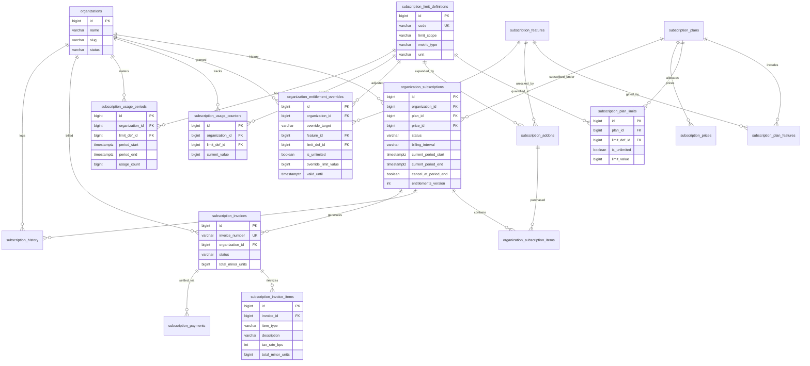
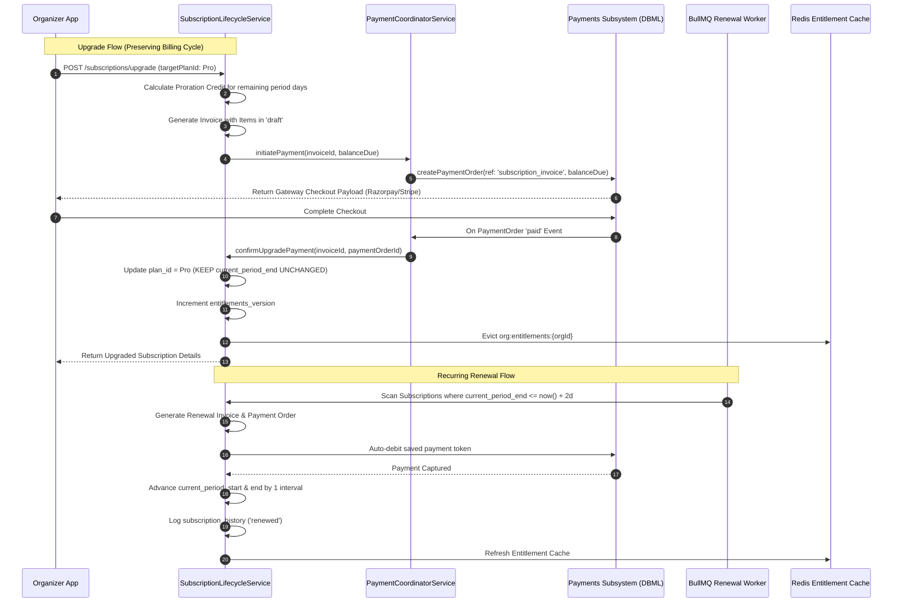
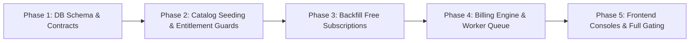

# Refined Orgatick Organization Subscription Architecture Proposal

---

## Executive Overview & Architectural Corrections

Following a comprehensive review of the initial subscription architecture and verification against the live codebase (`apps/backend`, `packages/contract`, and database blueprints), this revised proposal addresses all 16 required architectural corrections. 

### Core Architectural Fixes Introduced:
1. **Multi-Subscription Lifecycle with Partial Unique Index**: Removed the restrictive `UNIQUE (organization_id)` on `organization_subscriptions`. Organizations can now retain complete subscription records across time while enforcing that **exactly one subscription is active/effective at any time** via a PostgreSQL partial unique index.
2. **Normalized Limits with `subscription_limit_definitions`**: Replaced arbitrary string constants with a master limit catalog defining data types, operational scopes, and physical units.
3. **Elimination of the `-1` Unlimited Anti-Pattern**: Deprecated magic negative numbers. Unlimited limits are now governed by an explicit `is_unlimited: boolean` column accompanied by strict database check constraints.
4. **Dedicated Administrative Overrides Table**: Isolated bespoke tenant overrides into `subscription.organization_entitlement_overrides` with temporal validity (`valid_from`, `valid_until`) and mandatory auditor foreign keys, leaving base plan and add-on lines uncontaminated.
5. **Decoupled Three-Tier Precedence Engine**: Formally defined how Admin Overrides, Active Add-ons, and Base Plan catalog rules resolve dynamically with sub-millisecond Redis caching and versioned invalidation.
6. **Immutable Invoicing via `subscription_invoice_items`**: Extracted line items into a dedicated table capturing itemized snapshots (base fee, add-ons, proration credits, configurable tax rates) for permanent fiscal auditability.
7. **Proration-Preserving Upgrades**: Immediate plan upgrades now preserve original renewal dates, calculating prorated balance deltas without altering billing cycle anchors unless explicitly requested.
8. **Dual-Gate Governance Alignment**: Explicitly reconciled subscription entitlements with existing `organization_pricing_settings` (KYC compliance gating) and `organization_commission_settings` (ticket cut percentages) without duplicating business logic.

---

## 1. Final Recommended Database Tables

The subscription module operates in a dedicated, isolated PostgreSQL schema: `subscription`.

```text
subscription/
├── Master Catalog
│   ├── subscription_plans                      (Tiers: FREE, STARTER, PRO, ENTERPRISE)
│   ├── subscription_features                   (Master capability catalog)
│   ├── subscription_plan_features              (Plan-to-feature matrix)
│   ├── subscription_limit_definitions          (Standard metric/limit registry)
│   ├── subscription_plan_limits                (Plan capacity values & unlimited flags)
│   ├── subscription_prices                     (Temporal multi-currency pricing)
│   └── subscription_addons                     (Purchasable add-on catalog)
├── Tenant Subscription State & Entitlements
│   ├── organization_subscriptions              (Current and historical subscription contracts)
│   ├── organization_subscription_items         (Attached base plans & purchased add-ons)
│   ├── organization_entitlement_overrides      (Bespoke temporal administrative exceptions)
│   └── subscription_history                    (Chronological lifecycle audit journal)
├── Usage Tracking & Metering
│   ├── subscription_usage_counters             (Live continuous resource gauges)
│   └── subscription_usage_periods              (Periodic rolling quota windows)
└── Billing & Invoicing
    ├── subscription_invoices                   (SaaS recurring tax invoice headers)
    ├── subscription_invoice_items              (Immutable invoice line items & proration)
    └── subscription_payments                   (Transaction execution linked to payments subsystem)
```

---

## 2. Complete Column Definitions & Data Types

### 2.1 Catalog Tables

#### 1. `subscription.subscription_plans`
Defines available subscription packages.
- `id`: `BIGINT GENERATED ALWAYS AS IDENTITY PRIMARY KEY`
- `code`: `VARCHAR(50) NOT NULL UNIQUE` (e.g. `'free'`, `'starter'`, `'professional'`, `'enterprise'`)
- `name`: `VARCHAR(100) NOT NULL`
- `description`: `TEXT NULL`
- `tier_level`: `INT NOT NULL` (Ordinal rank: Free=0, Starter=10, Pro=20, Enterprise=30; enables deterministic comparison for upgrade vs downgrade)
- `is_active`: `BOOLEAN NOT NULL DEFAULT true`
- `is_public`: `BOOLEAN NOT NULL DEFAULT true` (Set false for custom/negotiated enterprise tiers)
- `trial_period_days`: `INT NOT NULL DEFAULT 0`
- `sort_order`: `INT NOT NULL DEFAULT 0`
- `created_at`: `TIMESTAMPTZ NOT NULL DEFAULT now()`
- `updated_at`: `TIMESTAMPTZ NOT NULL DEFAULT now()`

#### 2. `subscription.subscription_features`
Dictionary of discrete functional flags that can be toggled per plan.
- `id`: `BIGINT GENERATED ALWAYS AS IDENTITY PRIMARY KEY`
- `code`: `VARCHAR(100) NOT NULL UNIQUE` (e.g. `'custom_branding'`, `'ticket_template_editor'`, `'custom_roles'`, `'api_access'`, `'webhooks'`, `'custom_domain'`)
- `name`: `VARCHAR(150) NOT NULL`
- `description`: `TEXT NULL`
- `category`: `VARCHAR(50) NOT NULL` (e.g. `'branding'`, `'governance'`, `'developer'`, `'ticketing'`)
- `is_active`: `BOOLEAN NOT NULL DEFAULT true`
- `created_at`: `TIMESTAMPTZ NOT NULL DEFAULT now()`
- `updated_at`: `TIMESTAMPTZ NOT NULL DEFAULT now()`

#### 3. `subscription.subscription_plan_features`
Mapping linking plans to features with boolean or tiered values.
- `id`: `BIGINT GENERATED ALWAYS AS IDENTITY PRIMARY KEY`
- `plan_id`: `BIGINT NOT NULL REFERENCES subscription.subscription_plans(id) ON DELETE CASCADE`
- `feature_id`: `BIGINT NOT NULL REFERENCES subscription.subscription_features(id) ON DELETE CASCADE`
- `is_included`: `BOOLEAN NOT NULL DEFAULT true`
- `feature_level`: `VARCHAR(50) NULL` (e.g. `'basic'`, `'advanced'`, `'unlimited'`)
- `created_at`: `TIMESTAMPTZ NOT NULL DEFAULT now()`
- `updated_at`: `TIMESTAMPTZ NOT NULL DEFAULT now()`

#### 4. `subscription.subscription_limit_definitions`
**[NEW - Correction 3]** Master registry of all metered metrics, scopes, and physical units.
- `id`: `BIGINT GENERATED ALWAYS AS IDENTITY PRIMARY KEY`
- `code`: `VARCHAR(100) NOT NULL UNIQUE` (e.g. `'max_active_events'`, `'max_team_members'`, `'max_storage_bytes'`, `'max_custom_roles'`, `'max_monthly_api_requests'`, `'analytics_retention_days'`)
- `name`: `VARCHAR(150) NOT NULL`
- `description`: `TEXT NULL`
- `limit_scope`: `VARCHAR(30) NOT NULL` (`'concurrent'`, `'total'`, `'monthly_quota'`, `'retention_window'`)
- `metric_type`: `VARCHAR(30) NOT NULL` (`'gauge'`, `'counter'`, `'time_interval'`)
- `unit`: `VARCHAR(30) NOT NULL` (`'count'`, `'bytes'`, `'days'`, `'requests'`)
- `is_active`: `BOOLEAN NOT NULL DEFAULT true`
- `created_at`: `TIMESTAMPTZ NOT NULL DEFAULT now()`
- `updated_at`: `TIMESTAMPTZ NOT NULL DEFAULT now()`

#### 5. `subscription.subscription_plan_limits`
**[CORRECTED - Correction 4]** Capacity allocations per plan. The magic number `-1` is eliminated in favor of explicit nullability with boolean flag.
- `id`: `BIGINT GENERATED ALWAYS AS IDENTITY PRIMARY KEY`
- `plan_id`: `BIGINT NOT NULL REFERENCES subscription.subscription_plans(id) ON DELETE CASCADE`
- `limit_def_id`: `BIGINT NOT NULL REFERENCES subscription.subscription_limit_definitions(id) ON DELETE RESTRICT`
- `is_unlimited`: `BOOLEAN NOT NULL DEFAULT false`
- `limit_value`: `BIGINT NULL`
- `created_at`: `TIMESTAMPTZ NOT NULL DEFAULT now()`
- `updated_at`: `TIMESTAMPTZ NOT NULL DEFAULT now()`
- *Constraint*: `CHECK ((is_unlimited = true AND limit_value IS NULL) OR (is_unlimited = false AND limit_value IS NOT NULL AND limit_value >= 0))`

#### 6. `subscription.subscription_prices`
**[CORRECTED - Correction 7]** Temporal pricing catalog supporting versioned price modifications without breaking existing agreements.
- `id`: `BIGINT GENERATED ALWAYS AS IDENTITY PRIMARY KEY`
- `plan_id`: `BIGINT NOT NULL REFERENCES subscription.subscription_plans(id) ON DELETE CASCADE`
- `currency`: `VARCHAR(3) NOT NULL DEFAULT 'INR'` (ISO 4217 Currency Code)
- `billing_interval`: `VARCHAR(20) NOT NULL` (`'month'`, `'year'`)
- `price_in_minor_units`: `BIGINT NOT NULL` (e.g. `199900` paise = ₹1,999.00)
- `is_active`: `BOOLEAN NOT NULL DEFAULT true`
- `valid_from`: `TIMESTAMPTZ NOT NULL DEFAULT now()`
- `valid_to`: `TIMESTAMPTZ NULL` (Null denotes current active price; set to timestamp when superseded)
- `created_at`: `TIMESTAMPTZ NOT NULL DEFAULT now()`
- `updated_at`: `TIMESTAMPTZ NOT NULL DEFAULT now()`
- *Constraint*: `CHECK (price_in_minor_units >= 0)`

#### 7. `subscription.subscription_addons`
**[CORRECTED - Correction 4, 7]** Modular add-ons for capacity or features with temporal pricing.
- `id`: `BIGINT GENERATED ALWAYS AS IDENTITY PRIMARY KEY`
- `code`: `VARCHAR(100) NOT NULL UNIQUE` (e.g. `'addon_storage_50gb'`, `'addon_seats_5'`)
- `name`: `VARCHAR(150) NOT NULL`
- `description`: `TEXT NULL`
- `addon_type`: `VARCHAR(30) NOT NULL` (`'limit_increase'`, `'feature_unlock'`)
- `target_limit_def_id`: `BIGINT NULL REFERENCES subscription.subscription_limit_definitions(id) ON DELETE RESTRICT`
- `target_feature_id`: `BIGINT NULL REFERENCES subscription.subscription_features(id) ON DELETE RESTRICT`
- `is_unlimited`: `BOOLEAN NOT NULL DEFAULT false`
- `increase_value`: `BIGINT NULL` (e.g. `53687091200` bytes for 50GB, `5` seats)
- `currency`: `VARCHAR(3) NOT NULL DEFAULT 'INR'`
- `billing_interval`: `VARCHAR(20) NOT NULL DEFAULT 'month'` (`'month'`, `'year'`)
- `price_in_minor_units`: `BIGINT NOT NULL`
- `is_active`: `BOOLEAN NOT NULL DEFAULT true`
- `valid_from`: `TIMESTAMPTZ NOT NULL DEFAULT now()`
- `valid_to`: `TIMESTAMPTZ NULL`
- `created_at`: `TIMESTAMPTZ NOT NULL DEFAULT now()`
- `updated_at`: `TIMESTAMPTZ NOT NULL DEFAULT now()`
- *Constraint*: `CHECK ((is_unlimited = true AND increase_value IS NULL) OR (is_unlimited = false AND increase_value IS NOT NULL AND increase_value > 0) OR (addon_type = 'feature_unlock'))`

---

### 2.2 Tenant Subscription & Entitlement Tables

#### 8. `subscription.organization_subscriptions`
**[CORRECTED - Correction 1, 8, 10, 12]** Supports multiple records per organization over time with single active status validation.
- `id`: `BIGINT GENERATED ALWAYS AS IDENTITY PRIMARY KEY`
- `organization_id`: `BIGINT NOT NULL REFERENCES organization.organizations(id) ON DELETE RESTRICT`
- `plan_id`: `BIGINT NOT NULL REFERENCES subscription.subscription_plans(id) ON DELETE RESTRICT`
- `price_id`: `BIGINT NULL REFERENCES subscription.subscription_prices(id) ON DELETE RESTRICT` (Null for Free tier)
- `status`: `VARCHAR(30) NOT NULL DEFAULT 'active'` (`'trialing'`, `'active'`, `'past_due'`, `'grace_period'`, `'paused'`, `'canceled'`, `'expired'`)
- `billing_interval`: `VARCHAR(20) NOT NULL DEFAULT 'none'` (`'none'`, `'month'`, `'year'`)
- `currency`: `VARCHAR(3) NOT NULL DEFAULT 'INR'`
- `current_period_start`: `TIMESTAMPTZ NOT NULL DEFAULT now()`
- `current_period_end`: `TIMESTAMPTZ NULL` (Null for perpetual Free plans; explicit ISO timestamp for paid cycles)
- `trial_start`: `TIMESTAMPTZ NULL`
- `trial_end`: `TIMESTAMPTZ NULL`
- `grace_period_end`: `TIMESTAMPTZ NULL`
- `cancel_at_period_end`: `BOOLEAN NOT NULL DEFAULT false`
- `canceled_at`: `TIMESTAMPTZ NULL`
- `cancellation_reason`: `VARCHAR(500) NULL`
- `pending_plan_id`: `BIGINT NULL REFERENCES subscription.subscription_plans(id)` (For scheduled downgrades)
- `pending_price_id`: `BIGINT NULL REFERENCES subscription.subscription_prices(id)`
- `pending_change_effective_at`: `TIMESTAMPTZ NULL` (Effective timestamp of scheduled change)
- `auto_renew`: `BOOLEAN NOT NULL DEFAULT true`
- `version`: `INT NOT NULL DEFAULT 1` (Optimistic concurrency counter)
- `entitlements_version`: `INT NOT NULL DEFAULT 1` (Increments on entitlement mutation to invalidate caches)
- `created_at`: `TIMESTAMPTZ NOT NULL DEFAULT now()`
- `updated_at`: `TIMESTAMPTZ NOT NULL DEFAULT now()`

#### 9. `subscription.organization_subscription_items`
Purchased items linked to an active subscription agreement.
- `id`: `BIGINT GENERATED ALWAYS AS IDENTITY PRIMARY KEY`
- `subscription_id`: `BIGINT NOT NULL REFERENCES subscription.organization_subscriptions(id) ON DELETE CASCADE`
- `item_type`: `VARCHAR(30) NOT NULL` (`'plan'`, `'addon'`)
- `plan_id`: `BIGINT NULL REFERENCES subscription.subscription_plans(id) ON DELETE RESTRICT`
- `addon_id`: `BIGINT NULL REFERENCES subscription.subscription_addons(id) ON DELETE RESTRICT`
- `quantity`: `INT NOT NULL DEFAULT 1`
- `unit_price_minor_units`: `BIGINT NOT NULL DEFAULT 0`
- `currency`: `VARCHAR(3) NOT NULL DEFAULT 'INR'`
- `is_active`: `BOOLEAN NOT NULL DEFAULT true`
- `started_at`: `TIMESTAMPTZ NOT NULL DEFAULT now()`
- `ended_at`: `TIMESTAMPTZ NULL`
- `created_at`: `TIMESTAMPTZ NOT NULL DEFAULT now()`
- `updated_at`: `TIMESTAMPTZ NOT NULL DEFAULT now()`

#### 10. `subscription.organization_entitlement_overrides`
**[NEW - Correction 2, 11]** Dedicated table for temporary or negotiated administrative exceptions.
- `id`: `BIGINT GENERATED ALWAYS AS IDENTITY PRIMARY KEY`
- `organization_id`: `BIGINT NOT NULL REFERENCES organization.organizations(id) ON DELETE CASCADE`
- `override_target`: `VARCHAR(30) NOT NULL` (`'feature'`, `'limit'`)
- `feature_id`: `BIGINT NULL REFERENCES subscription.subscription_features(id) ON DELETE CASCADE`
- `limit_def_id`: `BIGINT NULL REFERENCES subscription.subscription_limit_definitions(id) ON DELETE CASCADE`
- `is_unlimited`: `BOOLEAN NOT NULL DEFAULT false`
- `override_limit_value`: `BIGINT NULL`
- `override_boolean_value`: `BOOLEAN NULL`
- `reason`: `VARCHAR(500) NOT NULL`
- `authorized_by`: `BIGINT NOT NULL REFERENCES identity.users(id) ON DELETE RESTRICT`
- `valid_from`: `TIMESTAMPTZ NOT NULL DEFAULT now()`
- `valid_until`: `TIMESTAMPTZ NULL` (Null denotes indefinite exception; otherwise auto-expires)
- `created_at`: `TIMESTAMPTZ NOT NULL DEFAULT now()`
- `updated_at`: `TIMESTAMPTZ NOT NULL DEFAULT now()`
- *Constraint*: `CHECK ((override_target = 'feature' AND feature_id IS NOT NULL AND limit_def_id IS NULL) OR (override_target = 'limit' AND limit_def_id IS NOT NULL AND feature_id IS NULL))`

#### 11. `subscription.subscription_history`
**[CORRECTED - Correction 1, 10]** Immutable audit trail referencing the subscription.
- `id`: `BIGINT GENERATED ALWAYS AS IDENTITY PRIMARY KEY`
- `organization_id`: `BIGINT NOT NULL REFERENCES organization.organizations(id) ON DELETE CASCADE`
- `subscription_id`: `BIGINT NOT NULL REFERENCES subscription.organization_subscriptions(id) ON DELETE CASCADE`
- `event_type`: `VARCHAR(50) NOT NULL` (`'created'`, `'renewed'`, `'upgraded'`, `'downgrade_scheduled'`, `'downgrade_executed'`, `'canceled'`, `'expired'`, `'grace_period_entered'`, `'payment_failed'`, `'addon_added'`, `'addon_removed'`, `'override_granted'`, `'override_revoked'`)
- `from_plan_id`: `BIGINT NULL REFERENCES subscription.subscription_plans(id)`
- `to_plan_id`: `BIGINT NULL REFERENCES subscription.subscription_plans(id)`
- `from_status`: `VARCHAR(30) NULL`
- `to_status`: `VARCHAR(30) NULL`
- `reason`: `VARCHAR(500) NULL`
- `metadata`: `JSONB NULL`
- `actor_type`: `VARCHAR(30) NOT NULL DEFAULT 'system'` (`'user'`, `'admin'`, `'system'`, `'webhook'`)
- `actor_id`: `BIGINT NULL REFERENCES identity.users(id)`
- `actor_name`: `VARCHAR(255) NULL`
- `created_at`: `TIMESTAMPTZ NOT NULL DEFAULT now()`

---

### 2.3 Usage Tracking Tables

#### 12. `subscription.subscription_usage_counters`
**[CORRECTED - Correction 9]** Tracks continuous gauge metrics (active events, team members, storage bytes, custom roles).
- `id`: `BIGINT GENERATED ALWAYS AS IDENTITY PRIMARY KEY`
- `organization_id`: `BIGINT NOT NULL REFERENCES organization.organizations(id) ON DELETE CASCADE`
- `limit_def_id`: `BIGINT NOT NULL REFERENCES subscription.subscription_limit_definitions(id) ON DELETE RESTRICT`
- `current_value`: `BIGINT NOT NULL DEFAULT 0`
- `last_recalculated_at`: `TIMESTAMPTZ NOT NULL DEFAULT now()`
- `updated_at`: `TIMESTAMPTZ NOT NULL DEFAULT now()`
- *Constraint*: `CHECK (current_value >= 0)`

#### 13. `subscription.subscription_usage_periods`
**[CORRECTED - Correction 9]** Tracks metered periodic quotas (e.g. monthly API calls).
- `id`: `BIGINT GENERATED ALWAYS AS IDENTITY PRIMARY KEY`
- `organization_id`: `BIGINT NOT NULL REFERENCES organization.organizations(id) ON DELETE CASCADE`
- `limit_def_id`: `BIGINT NOT NULL REFERENCES subscription.subscription_limit_definitions(id) ON DELETE RESTRICT`
- `period_start`: `TIMESTAMPTZ NOT NULL`
- `period_end`: `TIMESTAMPTZ NOT NULL`
- `usage_count`: `BIGINT NOT NULL DEFAULT 0`
- `limit_snapshot`: `BIGINT NULL` (The limit quota in effect for that historical window)
- `is_unlimited`: `BOOLEAN NOT NULL DEFAULT false`
- `created_at`: `TIMESTAMPTZ NOT NULL DEFAULT now()`
- `updated_at`: `TIMESTAMPTZ NOT NULL DEFAULT now()`
- *Constraint*: `CHECK (period_end > period_start AND usage_count >= 0)`

---

### 2.4 Billing & Invoicing Tables

#### 14. `subscription.subscription_invoices`
Formal tax and renewal invoice headers.
- `id`: `BIGINT GENERATED ALWAYS AS IDENTITY PRIMARY KEY`
- `public_id`: `VARCHAR(36) NOT NULL UNIQUE` (External ULID/UUID)
- `invoice_number`: `VARCHAR(100) NOT NULL UNIQUE` (e.g. `'INV-SUB-2026-00042'`)
- `organization_id`: `BIGINT NOT NULL REFERENCES organization.organizations(id) ON DELETE RESTRICT`
- `subscription_id`: `BIGINT NOT NULL REFERENCES subscription.organization_subscriptions(id) ON DELETE RESTRICT`
- `billing_reason`: `VARCHAR(50) NOT NULL` (`'subscription_cycle'`, `'subscription_create'`, `'subscription_upgrade'`, `'addon_purchase'`)
- `status`: `VARCHAR(30) NOT NULL DEFAULT 'draft'` (`'draft'`, `'open'`, `'paid'`, `'uncollectible'`, `'void'`)
- `currency`: `VARCHAR(3) NOT NULL DEFAULT 'INR'`
- `subtotal_minor_units`: `BIGINT NOT NULL DEFAULT 0`
- `tax_amount_minor_units`: `BIGINT NOT NULL DEFAULT 0`
- `total_minor_units`: `BIGINT NOT NULL DEFAULT 0`
- `proration_credit_minor_units`: `BIGINT NOT NULL DEFAULT 0`
- `period_start`: `TIMESTAMPTZ NOT NULL`
- `period_end`: `TIMESTAMPTZ NOT NULL`
- `due_date`: `TIMESTAMPTZ NOT NULL`
- `paid_at`: `TIMESTAMPTZ NULL`
- `pdf_url`: `VARCHAR(1000) NULL`
- `created_at`: `TIMESTAMPTZ NOT NULL DEFAULT now()`
- `updated_at`: `TIMESTAMPTZ NOT NULL DEFAULT now()`

#### 15. `subscription.subscription_invoice_items`
**[NEW - Correction 5, 13]** Immutable itemized line items with dynamic tax configuration.
- `id`: `BIGINT GENERATED ALWAYS AS IDENTITY PRIMARY KEY`
- `invoice_id`: `BIGINT NOT NULL REFERENCES subscription.subscription_invoices(id) ON DELETE CASCADE`
- `item_type`: `VARCHAR(30) NOT NULL` (`'plan_subscription'`, `'addon_charge'`, `'proration_credit'`, `'manual_adjustment'`)
- `description`: `VARCHAR(255) NOT NULL` (e.g. `'Professional Plan - Monthly (Prorated 18 Days)'`)
- `plan_id`: `BIGINT NULL REFERENCES subscription.subscription_plans(id)`
- `addon_id`: `BIGINT NULL REFERENCES subscription.subscription_addons(id)`
- `price_id`: `BIGINT NULL REFERENCES subscription.subscription_prices(id)`
- `quantity`: `INT NOT NULL DEFAULT 1`
- `unit_price_minor_units`: `BIGINT NOT NULL DEFAULT 0`
- `subtotal_minor_units`: `BIGINT NOT NULL DEFAULT 0`
- `tax_type`: `VARCHAR(50) NOT NULL DEFAULT 'GST'` (`'GST'`, `'VAT'`, `'SALES_TAX'`, `'EXEMPT'`)
- `tax_rate_bps`: `INT NOT NULL` (Configured basis points: 1800 = 18.00% GST, 0 = Export Exempt)
- `tax_amount_minor_units`: `BIGINT NOT NULL DEFAULT 0`
- `total_minor_units`: `BIGINT NOT NULL DEFAULT 0`
- `period_start`: `TIMESTAMPTZ NOT NULL`
- `period_end`: `TIMESTAMPTZ NOT NULL`
- `created_at`: `TIMESTAMPTZ NOT NULL DEFAULT now()`

#### 16. `subscription.subscription_payments`
**[CORRECTED - Correction 6]** Payment attempts linking to the existing `payments` financial subsystem.
- `id`: `BIGINT GENERATED ALWAYS AS IDENTITY PRIMARY KEY`
- `invoice_id`: `BIGINT NOT NULL REFERENCES subscription.subscription_invoices(id) ON DELETE RESTRICT`
- `organization_id`: `BIGINT NOT NULL REFERENCES organization.organizations(id) ON DELETE RESTRICT`
- `payment_order_id`: `BIGINT NULL` (Foreign key pointing to `payments.payment_orders.id` in the payments schema)
- `amount_minor_units`: `BIGINT NOT NULL`
- `currency`: `VARCHAR(3) NOT NULL DEFAULT 'INR'`
- `status`: `VARCHAR(30) NOT NULL DEFAULT 'pending'` (`'pending'`, `'authorized'`, `'captured'`, `'failed'`, `'refunded'`)
- `idempotency_key`: `VARCHAR(255) NOT NULL UNIQUE`
- `error_code`: `VARCHAR(100) NULL`
- `error_description`: `TEXT NULL`
- `created_at`: `TIMESTAMPTZ NOT NULL DEFAULT now()`
- `updated_at`: `TIMESTAMPTZ NOT NULL DEFAULT now()`

---

## 3. Primary & Foreign Key Relationships

```text
subscription.subscription_plan_features.plan_id            ──▶ subscription.subscription_plans.id (CASCADE)
subscription.subscription_plan_features.feature_id         ──▶ subscription.subscription_features.id (CASCADE)

subscription.subscription_plan_limits.plan_id              ──▶ subscription.subscription_plans.id (CASCADE)
subscription.subscription_plan_limits.limit_def_id         ──▶ subscription.subscription_limit_definitions.id (RESTRICT)

subscription.subscription_prices.plan_id                   ──▶ subscription.subscription_plans.id (CASCADE)

subscription.subscription_addons.target_limit_def_id       ──▶ subscription.subscription_limit_definitions.id (RESTRICT)
subscription.subscription_addons.target_feature_id         ──▶ subscription.subscription_features.id (RESTRICT)

subscription.organization_subscriptions.organization_id    ──▶ organization.organizations.id (RESTRICT)
subscription.organization_subscriptions.plan_id            ──▶ subscription.subscription_plans.id (RESTRICT)
subscription.organization_subscriptions.price_id           ──▶ subscription.subscription_prices.id (RESTRICT)
subscription.organization_subscriptions.pending_plan_id    ──▶ subscription.subscription_plans.id (RESTRICT)
subscription.organization_subscriptions.pending_price_id   ──▶ subscription.subscription_prices.id (RESTRICT)

subscription.organization_subscription_items.subscription_id ──▶ subscription.organization_subscriptions.id (CASCADE)
subscription.organization_subscription_items.plan_id       ──▶ subscription.subscription_plans.id (RESTRICT)
subscription.organization_subscription_items.addon_id      ──▶ subscription.subscription_addons.id (RESTRICT)

subscription.organization_entitlement_overrides.organization_id ──▶ organization.organizations.id (CASCADE)
subscription.organization_entitlement_overrides.feature_id ──▶ subscription.subscription_features.id (CASCADE)
subscription.organization_entitlement_overrides.limit_def_id ──▶ subscription.subscription_limit_definitions.id (CASCADE)
subscription.organization_entitlement_overrides.authorized_by ──▶ identity.users.id (RESTRICT)

subscription.subscription_history.organization_id          ──▶ organization.organizations.id (CASCADE)
subscription.subscription_history.subscription_id          ──▶ subscription.organization_subscriptions.id (CASCADE)
subscription.subscription_history.from_plan_id             ──▶ subscription.subscription_plans.id (SET NULL)
subscription.subscription_history.to_plan_id               ──▶ subscription.subscription_plans.id (SET NULL)
subscription.subscription_history.actor_id                 ──▶ identity.users.id (SET NULL)

subscription.subscription_usage_counters.organization_id   ──▶ organization.organizations.id (CASCADE)
subscription.subscription_usage_counters.limit_def_id      ──▶ subscription.subscription_limit_definitions.id (RESTRICT)

subscription.subscription_usage_periods.organization_id    ──▶ organization.organizations.id (CASCADE)
subscription.subscription_usage_periods.limit_def_id       ──▶ subscription.subscription_limit_definitions.id (RESTRICT)

subscription.subscription_invoices.organization_id         ──▶ organization.organizations.id (RESTRICT)
subscription.subscription_invoices.subscription_id         ──▶ subscription.organization_subscriptions.id (RESTRICT)

subscription.subscription_invoice_items.invoice_id         ──▶ subscription.subscription_invoices.id (CASCADE)
subscription.subscription_invoice_items.plan_id            ──▶ subscription.subscription_plans.id (SET NULL)
subscription.subscription_invoice_items.addon_id           ──▶ subscription.subscription_addons.id (SET NULL)
subscription.subscription_invoice_items.price_id           ──▶ subscription.subscription_prices.id (SET NULL)

subscription.subscription_payments.invoice_id              ──▶ subscription.subscription_invoices.id (RESTRICT)
subscription.subscription_payments.organization_id         ──▶ organization.organizations.id (RESTRICT)
```

---

## 4. Unique Constraints and Indexes

### 4.1 Unique Constraints & PostgreSQL Partial Indexes
1. **Single Active Primary Subscription [Correction 1]**:
   ```sql
   CREATE UNIQUE INDEX uq_org_subscriptions_active_status 
   ON subscription.organization_subscriptions (organization_id) 
   WHERE status IN ('active', 'trialing', 'past_due', 'grace_period');
   ```
   *Justification*: Eliminates split-brain subscription states while allowing an organization to retain dozens of expired/canceled subscription rows for full contractual auditability.

2. **Catalog Uniqueness**:
   - `subscription_plans`: `UNIQUE (code)`
   - `subscription_features`: `UNIQUE (code)`
   - `subscription_limit_definitions`: `UNIQUE (code)`
   - `subscription_plan_features`: `UNIQUE (plan_id, feature_id)`
   - `subscription_plan_limits`: `UNIQUE (plan_id, limit_def_id)`
   - `subscription_prices`: `UNIQUE (plan_id, currency, billing_interval, valid_from)`
   - `subscription_addons`: `UNIQUE (code)`

3. **Usage Tracking Uniqueness [Correction 9]**:
   - Continuous counters:
     ```sql
     CREATE UNIQUE INDEX uq_usage_counters_org_limit 
     ON subscription.subscription_usage_counters (organization_id, limit_def_id);
     ```
   - Periodic meter windows:
     ```sql
     CREATE UNIQUE INDEX uq_usage_periods_org_limit_window 
     ON subscription.subscription_usage_periods (organization_id, limit_def_id, period_start, period_end);
     ```

4. **Invoicing Uniqueness**:
   - `subscription_invoices`: `UNIQUE (public_id)`, `UNIQUE (invoice_number)`
   - `subscription_payments`: `UNIQUE (idempotency_key)`

### 4.2 Query Performance Indexes
- `idx_org_subscriptions_status_period_end`: `(status, current_period_end)` — for daily BullMQ renewal crons.
- `idx_org_subscriptions_grace_period`: `(status, grace_period_end)` — for dunning expiration jobs.
- `idx_subscription_history_org_created`: `(organization_id, created_at DESC)` — for tenant audit screens.
- `idx_entitlement_overrides_lookup`: `(organization_id, valid_from, valid_until)` — for active exception resolution.
- `idx_invoices_org_status`: `(organization_id, status)` — for tenant billing history tab.
- `idx_invoice_items_invoice_id`: `(invoice_id)` — for assembling invoice aggregates.

---

## 5. Updated Entity Relationship Diagram (Mermaid)



---

## 6. Subscription Lifecycle Workflows



### Clarified Workflow Rules:

1. **New Organization Creation & Free Tier Assignment [Correction 12]**:
   - `OrganizationService.create()` inserts `organization_subscriptions` with `plan_id = freePlan.id`, `price_id = null`, `status = 'active'`, `billing_interval = 'none'`.
   - `current_period_start = now()`, `current_period_end = NULL` (indicating perpetual lifetime).
   - Zero invoice or payment order is generated.
   - Monthly periodic quotas for Free tenants (such as API call limits) reset based on calendar months (`date_trunc('month', now())`) rather than subscription renewal boundaries.

2. **Immediate Upgrade with Date Preservation [Correction 8]**:
   - Upgrading from Starter to Pro on Day 10 of a 30-day month:
     $$\text{Remaining Ratio} = \frac{20\text{ days}}{30\text{ days}} = 0.6667$$
     $$\text{Credit} = \text{Starter Monthly Price} \times 0.6667$$
     $$\text{Charge} = (\text{Pro Monthly Price} \times 0.6667) - \text{Credit}$$
   - `current_period_end` remains locked to the original Day 30 date.
   - An itemized invoice (`subscription_invoice_items`) is issued detailing the gross Pro line item, the offset Starter credit line item, and the net balance.
   - **Only** if the customer explicitly requests a billing interval shift (e.g. Monthly to Annual) is `current_period_end` reset to `now() + 1 year`.

3. **Scheduled Downgrades**:
   - Downgrade requests do not alter current active rows. The target is recorded in `pending_plan_id` and `pending_change_effective_at = current_period_end`.
   - The organization maintains full higher-tier access until the clock passes `current_period_end`.
   - Upon renewal, the BullMQ worker applies `pending_plan_id`, clears pending columns, resets entitlements, and issues the lower invoice.

4. **Dunning & Grace Periods**:
   - Recurring charge failure transitions subscription to `past_due`, starts a 7-day grace period (`grace_period_end = now() + 7 days`), and alerts the tenant.
   - Entitlements remain active throughout the 7 days to protect ongoing live events.
   - If retries fail at Day 7, the subscription transitions to `expired`. Entitlements revert to Free tier rules, triggering the Non-Destructive Resource Freeze.

---

## 7. Entitlement Resolution Strategy

### 7.1 Multi-Source Precedence Engine [Correction 2, 11, 15]
When an endpoint protected by `@RequireEntitlement()` or `@RequireLimit()` executes, the effective permission is computed by evaluating three layers in strict hierarchical order:

```text
┌─────────────────────────────────────────────────────────────────────────────┐
│                       ENTITLEMENT RESOLUTION ENGINE                         │
├─────────────────────────────────────────────────────────────────────────────┤
│ 1. ADMINISTRATIVE OVERRIDES (Highest Precedence)                            │
│    Inspect subscription.organization_entitlement_overrides                  │
│    WHERE organization_id = :id                                              │
│      AND valid_from <= now() AND (valid_until IS NULL OR valid_until > now())│
│    - If feature match found: Take boolean override immediately.             │
│    - If limit match found AND is_unlimited = true: Return UNLIMITED.        │
│    - If limit match found: Use override_limit_value as base.                │
├─────────────────────────────────────────────────────────────────────────────┤
│ 2. ACTIVE PURCHASED ADD-ONS (Additive Stacking Layer)                       │
│    Inspect organization_subscription_items (item_type = 'addon', active)    │
│    JOIN subscription_addons                                                 │
│    - Feature Unlocks: If any active add-on unlocks feature: grant true.     │
│    - Limit Additions: Sum all (increase_value * quantity) additively.       │
│    - If any add-on grants is_unlimited = true: mark UNLIMITED.              │
├─────────────────────────────────────────────────────────────────────────────┤
│ 3. BASE PLAN CATALOG (Baseline Foundation)                                  │
│    Inspect active subscription.organization_subscriptions                   │
│    JOIN subscription_plan_limits / subscription_plan_features               │
│    - Features: Standard plan boolean flag.                                  │
│    - Limits: Standard plan limit_value (or is_unlimited = true).            │
└─────────────────────────────────────────────────────────────────────────────┘
```

### 7.2 Resolution Invariant Formula
$$\text{Effective Limit} = \begin{cases} 
\infty & \text{if Override, Add-on, or Base Plan is\_unlimited} = \text{true} \\
\text{Override Limit} + \sum \text{Addon Increases} & \text{if Override Limit exists} \\
\text{Base Plan Limit} + \sum \text{Addon Increases} & \text{otherwise}
\end{cases}$$

### 7.3 Cache Versioning & Invalidation Strategy [Correction 16]
- **Key Pattern**: `org:entitlements:{organizationId}`
- **Cache Format**: JSON payload containing all active boolean features, numerical limits, and their `is_unlimited` flags.
- **TTL**: 3600 seconds (1 hour) with eager eviction.
- **Atomic Invalidation Flow**:
  1. Any mutation modifying subscriptions, plan assignments, add-on line items, or admin overrides executes inside `@Transactional()`.
  2. The transaction increments `organization_subscriptions.entitlements_version = entitlements_version + 1`.
  3. Immediately upon transaction commit, `EntitlementCacheService` executes `redis.del('org:entitlements:' + orgId)`.
  4. A Redis Pub/Sub notification is published on channel `cache:invalidate:entitlements` with payload `{ organizationId, version }` to invalidate any local Node.js L1 in-process memoization.
  5. The next incoming request experiences a clean cache miss, fetches the authoritative database state, and repopulates the Redis hash with the incremented version tag.

---

## 8. Usage Tracking Strategy

### 8.1 Distinct Counter vs Metered Period Models [Correction 9]

1. **Continuous Resource Gauges (`subscription_usage_counters`)**:
   - Measures long-lived state: `max_active_events`, `max_team_members`, `max_storage_bytes`, `max_custom_roles`.
   - Primary Key: `(organization_id, limit_def_id)` ensures exactly one authoritative row per metric per organization.
   - Updated synchronously or through entity lifecycle subscribers (`afterInsert`, `afterRemove`).

2. **Periodic Rolling Quotas (`subscription_usage_periods`)**:
   - Measures metered consumption over a billing window: `max_monthly_api_requests`.
   - Bound by explicit `period_start` and `period_end`.
   - Ephemeral counts increment atomically in Redis (`INCRBY org:meter:{orgId}:{metric}:{periodStart}`).
   - BullMQ worker flushes Redis deltas to `subscription_usage_periods` every 15 minutes.

### 8.2 Concurrency & Transactional Lock Enforcement [Correction 9]
To prevent race conditions where concurrent requests breach limits, all capacity-consuming actions enforce transactional serialization at the PostgreSQL layer:

```typescript
@Transactional()
async assertAndConsumeCapacity(
  organizationId: bigint, 
  limitCode: string, 
  incrementBy = 1
): Promise<void> {
  // 1. Acquire deterministic transaction advisory lock scoped to org + metric
  const lockKey = hashLockKey(organizationId, limitCode);
  await this.dataSource.query(`SELECT pg_advisory_xact_lock($1)`, [lockKey]);

  // 2. Fetch effective limit via EntitlementService
  const entitlement = await this.entitlementService.getLimit(organizationId, limitCode);
  if (entitlement.isUnlimited) return;

  // 3. Query current continuous count directly within the transaction
  const counter = await this.usageRepo.findOne({
    where: { organizationId, limitDefinition: { code: limitCode } }
  });
  const currentVal = counter?.currentValue ?? 0n;

  if (currentVal + BigInt(incrementBy) > entitlement.limitValue) {
    throw new QuotaExceededException(
      `Organization limit reached for ${limitCode}. Allowed: ${entitlement.limitValue}, Current: ${currentVal}`
    );
  }

  // 4. Increment counter within the same atomic transaction
  await this.usageRepo.updateCounter(organizationId, limitCode, incrementBy);
}
```

---

## 9. Billing & Payment Integration

### 9.1 Interfacing with Planned `payments` Subsystem [Correction 6]
The subscription module **does not duplicate payment gateway integrations** (Razorpay, Stripe). It interfaces with the pending `payments` financial subsystem (`payments-schema.dbml`):

```text
┌────────────────────────────────────────────────────────┐
│             Subscription Billing Domain                │
│  - Invoice Generation & Itemization                    │
│  - Proration Delta Mathematics                         │
│  - Dunning Retries & Grace Schedules                   │
│  - Issues 'subscription_payments' record               │
└───────────────────────────┬────────────────────────────┘
                            │
                            │ 1. Calls PaymentOrderService.createOrder()
                            │    payload: {
                            │      reference_type: 'subscription_invoice',
                            │      reference_id: invoice.id,
                            │      organization_id: org.id,
                            │      amount: invoice.totalMinorUnits,
                            │      currency: invoice.currency
                            │    }
                            ▼
┌────────────────────────────────────────────────────────┐
│               Payments Subsystem Core                  │
│  - payments.payment_orders (Lifecycle & Expiry)        │
│  - payments.payment_attempts (Gateway Attempts)        │
│  - payments.webhook_events (Idempotent Webhook Log)    │
│  - Razorpay / Stripe SDK API Calls                     │
└───────────────────────────┬────────────────────────────┘
                            │
                            │ 2. Emits Domain Event: 'payment_order.captured'
                            ▼
┌────────────────────────────────────────────────────────┐
│       Subscription Payment Coordinator Listener        │
│  - Receives event matching 'subscription_invoice'      │
│  - Updates subscription_payments status = 'captured'   │
│  - Marks subscription_invoices status = 'paid'         │
│  - Invokes SubscriptionLifecycleService to advance     │
│    period or apply plan upgrade                        │
└────────────────────────────────────────────────────────┘
```

### 9.2 Configurable Tax Architecture [Correction 13]
- Removed hardcoded 18.00% GST defaults.
- `TaxCalculationService` dynamically resolves the applicable tax schedule before invoice drafting:
  1. Queries the organization's verified registered address (`Address` aggregate via `organization.address_id`).
  2. Evaluates country:
     - **Domestic (India)**: Identifies Intra-State (CGST 9% + SGST 9%) vs Inter-State (IGST 18%). Stores composite `tax_rate_bps: 1800`, `tax_type: 'GST'`.
     - **International**: Evaluates export compliance. Applies Zero-Rated Export reverse charge: `tax_rate_bps: 0`, `tax_type: 'EXEMPT'`.
     - **Custom/Enterprise**: Tax exemption certificates registered in `organization_documents` bypass standard rates.
  3. Every invoice line item in `subscription_invoice_items` stores its own resolved `tax_rate_bps`, `tax_type`, and calculated `tax_amount_minor_units`.

### 9.3 Interaction with Governance & Finance Settings [Correction 14]
Orgatick already implements two critical organization settings. These are preserved and harmonized with subscriptions:

1. **`organization_pricing_settings` (`paid_events_enabled`)**:
   - **Current Rule**: KYC verification controls whether an organization can sell tickets for money (`paid_events_enabled`).
   - **Subscription Interaction (Dual-Gate Rule)**: Even if an organization purchases the **ENTERPRISE** plan, they **cannot** publish paid events if `OrganizationPricingSetting.paidEventsEnabled = false` due to missing bank details or failed KYC. Both gates must pass:
     $$\text{Can Sell Paid Tickets} = (\text{Plan Entitlement: Paid Events Enabled}) \land (\text{Organization KYC: paid\_events\_enabled})$$

2. **`organization_commission_settings` (`commission_percentage`)**:
   - **Current Rule**: Stores platform commission cut (default 7.00%) on event ticket revenue.
   - **Subscription Interaction**: Each plan includes a default commission rate (Free=7.00%, Starter=5.50%, Pro=3.50%, Enterprise=2.00%).
     - Upon subscription purchase/upgrade: The system updates `organization_commission_settings.commission_percentage` to match the new plan's rate.
     - **Custom Enterprise Exemption**: If platform admin flagged an organization with a custom negotiated contract rate, a boolean `is_custom_negotiated` prevents automated plan tier overrides.

---

## 10. Module Boundaries & Dependencies

Following NestJS and Turborepo guidelines, the subscription boundaries are strictly decoupled:

```text
apps/backend/src/modules/
├── subscription/
│   ├── catalog/                          (Private: Plans, Features, Limits, Prices)
│   ├── lifecycle/                        (Private: Subscriptions, Renewals, Downgrades)
│   ├── billing/                          (Private: Invoices, Tax, Dunning, Payments)
│   ├── usage/                            (Private: Metering, Counters, Locks)
│   ├── entitlements/                     (PUBLIC EXPORTED API)
│   │   ├── services/
│   │   │   ├── entitlement.service.ts    (Authoritative resolution service)
│   │   │   └── entitlement-cache.service.ts
│   │   ├── guards/
│   │   │   ├── subscription-entitlement.guard.ts (@RequireEntitlement)
│   │   │   └── subscription-limit.guard.ts       (@RequireLimit)
│   │   └── subscription-entitlements.module.ts
│   └── subscription.module.ts            (Umbrella Module)
```

### Dependency Direction Rules:
- **`EventModule` $\longrightarrow$ `SubscriptionEntitlementsModule`** (Calls `EntitlementService` / uses `@RequireLimit('max_active_events')`).
- **`OrganizationTeamModule` $\longrightarrow$ `SubscriptionEntitlementsModule`** (Uses `@RequireLimit('max_team_members')`).
- **`IdentityModule` $\longrightarrow$ `SubscriptionEntitlementsModule`** (Uses `@RequireLimit('max_custom_roles')`).
- **`SubscriptionModule` $\longrightarrow$ `PaymentsModule`** (Dispatches payment orders).
- **Prohibited**: Business modules never import subscription repositories, invoice services, or pricing internals.

---

## 11. Migration & Implementation Phases



### Phase 1: Database Schema & Contracts Package
- Run TypeORM migration creating PostgreSQL schema `subscription` and all 16 tables.
- Add Zod schemas to `packages/contract/src/subscription/` (Request DTOs, response envelopes, limit definitions).
- Run `pnpm turbo build --filter=@orgatick/contracts`.

### Phase 2: Catalog Seeding & Entitlement Engine
- Seed `subscription_limit_definitions`, `subscription_features`, `subscription_plans`, and `subscription_prices`.
- Implement `EntitlementService` with Redis caching, versioned cache eviction, and transactional advisory locking.
- Expose `@RequireEntitlement()` and `@RequireLimit()` guards.

### Phase 3: Zero-Downtime Free Plan Backfill
- Execute migration backfilling every existing organization in `organization.organizations` with an active **FREE** subscription (`current_period_end = NULL`).
- Initialize continuous usage counters (`subscription_usage_counters`) from existing table row counts (`organization_members`, `roles`).
- Hook `OrganizationService.create()` to automatically assign Free subscriptions upon tenant onboarding.

### Phase 4: Invoicing, Dunning & Payments Subsystem Linkage
- Build `SubscriptionInvoiceService` with itemized line items and dynamic tax calculation.
- Connect `SubscriptionPaymentCoordinator` to `payments.payment_orders` via domain events.
- Deploy BullMQ processor on `SUBSCRIPTION_QUEUE` for daily renewal and grace period evaluations.

### Phase 5: Frontends & Progressive Enforcement
- Deploy Platform Admin subscription console in `apps/admin` (catalog editor, override grants, dispute view).
- Deploy Organizer subscription and billing settings tab in `apps/organizer` (usage meters, plan selector, invoice downloads).
- Activate guards on event publishing and member invitation routes.

---

## 12. Remaining Business Decisions Requiring Approval

The following specific business policies must be confirmed by product stakeholders prior to implementation:

1. **Trial Period Eligibility**:
   - *Question*: Can an organization trial the **PROFESSIONAL** tier more than once if they spin down and resubscribe?
   - *Proposal*: Track `has_used_trial: boolean` in subscription history. An organization is restricted to a single 14-day trial of paid tiers across its lifetime.

2. **Grandfathering of Over-Quota Free Tenants**:
   - *Question*: If an existing organization already has 4 team members prior to subscription launch, but the new Free tier permits only 2 seats, what should occur?
   - *Proposal*: Adopt the non-destructive freeze. Existing members are not removed and keep access; invitations for a 5th member are blocked until the plan is upgraded to Starter.

3. **Multi-Currency Pricing Matrix**:
   - *Question*: Will Indian organizations be locked to INR and international organizations to USD, or can tenants choose their billing currency?
   - *Proposal*: Default currency strictly binds to the organization's registered country in `organization.addresses` (India $\to$ INR, All Others $\to$ USD) to avoid gateway cross-border FX surcharges.

4. **Add-on Proration Alignment**:
   - *Question*: When an add-on is purchased mid-cycle, should its billing cycle immediately align with the parent subscription renewal date?
   - *Proposal*: Yes. Add-ons are co-termed and prorated to match the parent subscription's `current_period_end`. They renew as a combined invoice item on the subsequent cycle.

---

## Summary of Architectural Conformance

| Correction Item | Verification in Revised Architecture |
| :--- | :--- |
| **1. Multi-Subscription History** | Resolved via PostgreSQL partial unique index `uq_org_subscriptions_active_status` on `organization_subscriptions`. |
| **2. Entitlement Versioning** | Resolved via explicit 3-tier precedence engine and dedicated `organization_entitlement_overrides` table. |
| **3. Master Limit Definitions** | Modeled in `subscription_limit_definitions` with explicit metric scopes, types, and physical units. |
| **4. Elimination of `-1`** | Modeled via `is_unlimited: boolean` and database `CHECK` constraints requiring null values when unlimited. |
| **5. Immutable Invoice Items** | Modeled in `subscription_invoice_items` with itemized base fees, credits, and tax rates. |
| **6. Payments Subsystem Linkage** | Integrated via `payment_order_id` bridge and domain events without duplicating payment gateway code. |
| **7. Price History & Effective Dates** | Supported in `subscription_prices` and `subscription_addons` via `valid_from` and `valid_to` timestamps. |
| **8. Upgrade Date Preservation** | Math formulated to preserve original `current_period_end` during upgrades; only interval switches reset dates. |
| **9. Usage Tracking & Concurrency** | Split into continuous gauges vs periodic meter windows with PostgreSQL transaction advisory locking. |
| **10. Missing Columns & Foreign Keys** | Added `pending_change_effective_at` and linked `subscription_history.subscription_id` with foreign key constraints. |
| **11. Admin Overrides Separation** | Separated into dedicated `organization_entitlement_overrides` table with audit fields and temporal validity. |
| **12. Free Subscription Semantics** | Formally clarified as lifetime (`current_period_end = NULL`), zero-cost, with calendar-month quota rollovers. |
| **13. Configurable Tax Calculation** | Decoupled from hardcoded 18% into `TaxCalculationService` supporting GST, VAT, and Export Exemptions. |
| **14. Governance & Pricing Alignment** | Dual-gate rule enforced: `OrganizationPricingSetting` KYC compliance acts as an absolute prerequisite. |
| **15. Precedence Hierarchy** | Formulated as: Admin Overrides $\to$ Active Add-ons (Additive) $\to$ Base Plan Catalog. |
| **16. Redis Invalidation & Versioning** | Implemented via `entitlements_version` increment, transactional eviction, and Redis Pub/Sub broadcast. |