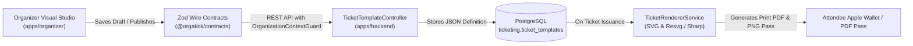

# Orgatick — Custom Ticket Template Editor Engineering Documentation

## 1. Executive Summary & Vision

The **Custom Ticket Template Editor** is a visual design studio engineered directly inside Orgatick (`apps/organizer`). It enables event organizers, operators, and administrators to design, customize, preview, and publish branded event tickets, badges, wristbands, and attendee passes.

It replaces static, hard-coded event tickets with a dynamic, production-quality visual studio where organizers can:
- Upload and frame custom background artwork (PNG, JPEG, WebP, up to 5MB) with automatic canvas resizing to match natural dimensions (e.g., 1920×1080).
- Visually drag, resize, rotate, and align dynamic event/attendee data placeholders.
- Reorder layer hierarchy with native drag-and-drop and normalized z-indexing.
- Configure typography, text alignment, colors via a fixed ReUI/Base UI Color Picker, quiet zones, and layer properties.
- Place a tamper-proof official ticket verification QR code complying with Orgatick's gate scanner protocol.
- Preview personalized passes in real-time with diverse sample attendee personas (Standard Attendee, VIP with assigned seating, and long-name stress tests).
- Navigate efficiently with full keyboard shortcut support (`Ctrl+Z`, `Ctrl+Y`, `Ctrl+D`, nudges, zoom, grid, preview).

### Development & Live Preview Routes
- **Studio Preview Route**: `apps/organizer/app/ticket-editor-preview/page.tsx`  
  Accessible at: `http://localhost:3001/ticket-editor-preview` (or via Cloudflare Tunnel: `https://dev-org.orgatick.site/ticket-editor-preview`).
- **Template Management Route**: `apps/organizer/app/(dashboard)/ticket-templates/page.tsx`  
  Accessible at: `http://localhost:3001/ticket-templates` (via organizer navigation sidebar).

---

## 2. Monorepo Architecture & Placement

Orgatick enforces a strict dependency direction: `apps/*` consumes `packages/*`, and `packages/*` never imports from `apps/*`.

```text
orgatick/
├── packages/
│   ├── contract/             # @orgatick/contracts (Zod wire contracts, DTOs, Enums)
│   └── ui/                   # @orgatick/ui (Shared Base UI + Tailwind v4 primitives, ReUI ColorPicker)
│
├── apps/
│   ├── organizer/            # apps/organizer (Organizer Operator Dashboard)
│   │   ├── app/
│   │   │   ├── (dashboard)/ticket-templates/  # Template management gallery
│   │   │   └── ticket-editor-preview/         # Standalone studio preview route
│   │   ├── components/ticket-editor/          # 15 focused UI components (< 200 lines each)
│   │   └── lib/ticket-editor/                 # 16 store, math, registry & helper modules
│   │
│   └── backend/              # apps/backend (NestJS API & Rendering Engine)
│       └── src/modules/ticket-template/       # (Planned) Entities, controllers, SVG/PNG renderer
```

### Strict Modular Decomposition (< 225 Lines Rule)
Every single file in the ticket editor module strictly adheres to Orgatick's modularity guidelines. The module comprises **31 files** totaling 3,177 lines of TypeScript and React code, with the largest file being 225 lines:

| Category | File | Lines | Responsibility |
|---|---|---|---|
| **Components** | `ticket-editor.tsx` | 85 | Studio root container, keyboard shortcuts listener, modal manager |
| **Components** | `editor-header.tsx` | 169 | Top utility bar: title, zoom, undo/redo, background trigger, preview |
| **Components** | `editor-canvas.tsx` | 90 | Center stage: CSS scale zoom, bounding box, 8 resize handles |
| **Components** | `editor-element-view.tsx` | 130 | Element renderer: text, badges, QR, logo, lock/hidden states |
| **Components** | `editor-field-library.tsx` | 122 | Left sidebar: dynamic field accordion, search, drag triggers |
| **Components** | `editor-inspector.tsx` | 70 | Right sidebar shell: tabs for Properties and Draggable Layers |
| **Components** | `editor-layers-panel.tsx` | 188 | Draggable layer stack: HTML5 drag-and-drop, lock, hide, delete |
| **Components** | `inspector-geometry.tsx` | 132 | Element geometry inspector: X, Y, W, H, rotation, opacity, z-index |
| **Components** | `inspector-typography.tsx` | 138 | Typography inspector: font family, size, weight, align, color picker |
| **Components** | `inspector-qr.tsx` | 91 | QR inspector: quiet zone margin, colors, error correction |
| **Components** | `inspector-canvas-settings.tsx` | 102 | Canvas setup: presets, dimensions, background color, grid snap |
| **Components** | `background-uploader.tsx` | 103 | 5MB artwork uploader: drag-drop, dimension reading, auto-sizing |
| **Components** | `editor-background-modal.tsx` | 156 | Modal dialog for background artwork management & presets |
| **Components** | `editor-preview-modal.tsx` | 167 | Live simulation modal: persona switcher, zoom, QR gate scanner |
| **Components** | `editor-shortcuts-modal.tsx` | 83 | Keyboard shortcuts cheat sheet dialog |
| **Lib / Store** | `editor.store.ts` | 225 | Zustand store definition: elements, canvas, selection, history actions |
| **Lib / Store** | `store-helpers.ts` | 66 | Pure state transformers: layer reordering, lock/hide, duplicate, delete |
| **Lib / Store** | `history-helpers.ts` | 19 | 50-step undo/redo snapshot buffer management |
| **Lib / Store** | `canvas-resize-helpers.ts` | 61 | Proportional coordinate re-scaling on canvas dimension change |
| **Lib / Store** | `coordinate-helpers.ts` | 79 | Viewport-to-canvas coordinate translation, grid snapping math |
| **Lib / Store** | `default-template.ts` | 166 | Sensible default template with sample elements |
| **Lib / Store** | `field-registry.ts` | 12 | Dynamic field registry aggregator |
| **Lib / Store** | `fields-attendee-event.ts` | 113 | Field definitions for Attendee & Event categories |
| **Lib / Store** | `fields-ticket-seating.ts` | 156 | Field definitions for Ticket, Seating, and Static categories |
| **Lib / Store** | `sample-attendees.ts` | 70 | Realistic attendee personas for live testing |
| **Lib / Store** | `shortcuts-config.ts` | 28 | Keyboard shortcut definitions & categorizations |
| **Lib / Store** | `use-editor-shortcuts.ts` | 155 | Event listener hook with input-safe hotkey detection |
| **Lib / Store** | `qr-renderer.tsx` | 96 | Lightweight vector SVG QR code matrix generator |
| **Lib / Store** | `canvas-presets.ts` | 24 | Canvas dimension presets (Horizontal, Badge, Wristband, 1080p) |
| **Lib / Store** | `editor-types.ts` | 78 | Complete TypeScript interfaces & type definitions |
| **Lib / Store** | `editor-constants.ts` | 3 | Constant boundaries (min element size, history limit) |

---

## 3. State Management Architecture (Zustand)

State is managed centrally via `useTicketEditorStore` in `apps/organizer/lib/ticket-editor/editor.store.ts` with **zero prop drilling**.

### 3.1 Store State Shape
```typescript
interface TicketEditorState {
  template: TicketTemplateDefinition;
  selectedElementId: string | null;
  zoom: number;                 // 0.5 to 2.0 (50% to 200%)
  showGrid: boolean;
  snapToGrid: boolean;
  gridSize: number;             // Default 10px
  history: TicketTemplateDefinition[]; // Max 50 snapshots
  historyIndex: number;
  previewOpen: boolean;
  backgroundModalOpen: boolean;
  shortcutsModalOpen: boolean;
  previewPersonaId: string;
}
```

### 3.2 Snapshot-Based Undo/Redo Engine
- Any mutating action (element move, resize, property change, layer reorder, dimension change, deletion) captures a deep snapshot of the `template` object before applying changes.
- The history stack is capped at 50 snapshots (`MAX_HISTORY_SNAPSHOTS = 50`) to maintain a minimal memory footprint.
- Pressing `Ctrl+Z` decrements `historyIndex` and restores the previous snapshot; `Ctrl+Y` increments `historyIndex`.
- The header displays real-time badges indicating available undo and redo counts.

### 3.3 Atomic Helpers Separation
To keep `editor.store.ts` compact and strictly maintainable:
- State mutators are extracted to `store-helpers.ts` (`moveElementLayerHelper`, `duplicateElementHelper`, `deleteElementHelper`, `toggleLockHelper`, `toggleHiddenHelper`).
- Snapshot history manipulation is isolated in `history-helpers.ts`.
- Coordinate calculations reside in `coordinate-helpers.ts`.

---

## 4. Canvas Geometry & Coordinate Translation

### 4.1 Logical Coordinates vs. Viewport Scaling
The canvas operates on an absolute **logical coordinate space** independent of the browser's physical viewport.
- Default resolution: **1200 × 600 px** (or custom up to **1920 × 1080 px** Full HD).
- The center stage applies CSS scaling via `transform: scale(zoom)` with `transform-origin: top left`.
- Container rules enforce strict bounds using `minWidth`, `maxWidth`, `minHeight`, and `maxHeight` matching `canvas.width * zoom` and `canvas.height * zoom`, guaranteeing pixel-accurate aspect ratio rendering without layout jitter or scrollbar popping.

### 4.2 Coordinate Normalization Formula
When dragging or resizing elements, client mouse coordinates are translated into logical canvas coordinates without floating-point drift:
$$\text{canvasX} = \frac{\text{clientX} - \text{canvasRect.left}}{\text{zoom}}$$
$$\text{canvasY} = \frac{\text{clientY} - \text{canvasRect.top}}{\text{zoom}}$$

### 4.3 Snapping & Boundary Constraints
- **Grid Snapping**: When `snapToGrid` is enabled:
  $$\text{snappedX} = \text{round}\left(\frac{\text{canvasX}}{\text{gridSize}}\right) \times \text{gridSize}$$
- **Minimum Element Size**: Elements enforce a strict floor of $20\text{px} \times 20\text{px}$ to prevent inverted bounding boxes during resize operations.
- **8 Interactive Resize Handles**: Handles located at NW, N, NE, E, SE, S, SW, W allow freeform and proportional scaling.

---

## 5. Background Artwork & Dynamic Canvas Auto-Sizing

### 5.1 Artwork Upload Specifications
- Supported formats: **PNG, JPEG, WebP, SVG**.
- Maximum file size: **5MB** (strictly validated in `background-uploader.tsx`).
- Organizers can upload custom background artwork via drag-and-drop or file picker.

### 5.2 Natural Dimension Detection
Using the browser's `Image()` API, the editor extracts the intrinsic pixel dimensions:
```typescript
const img = new Image();
img.onload = () => {
  const naturalWidth = img.naturalWidth;
  const naturalHeight = img.naturalHeight;
  // Offers automatic canvas resizing to match artwork
};
img.src = dataUrl;
```

### 5.3 Proportional Coordinate Re-scaling Algorithm
When an organizer chooses to resize the canvas to match uploaded artwork (e.g., from $1200 \times 600$ to $1920 \times 1080$), all existing elements are automatically rescaled proportionally via `canvas-resize-helpers.ts`:

$$\text{scaleX} = \frac{W_{\text{new}}}{W_{\text{old}}},\quad \text{scaleY} = \frac{H_{\text{new}}}{H_{\text{old}}}$$
$$X' = \text{round}(X \times \text{scaleX}),\quad Y' = \text{round}(Y \times \text{scaleY})$$
$$W_{\text{element}}' = \max\left(20, \text{round}(W_{\text{element}} \times \text{scaleX})\right)$$
$$H_{\text{element}}' = \max\left(20, \text{round}(H_{\text{element}} \times \text{scaleY})\right)$$
$$\text{fontSize}' = \max\left(8, \text{round}(\text{fontSize} \times \min(\text{scaleX}, \text{scaleY}))\right)$$

**Guarantees**: No elements are lost, placed off-screen, or shrunk below readable thresholds.

---

## 6. Draggable Layer Hierarchy & Reordering

Organizers manage the depth and stacking order of elements through a dedicated **Layers Panel** (`editor-layers-panel.tsx`) integrated into the inspector sidebar.

```text
┌───────────────────────────────────────────────┐
│ [ Properties ]       [ Layers (5) ]           │
├───────────────────────────────────────────────┤
│ ≡  [QR]   Official Verification QR   👁  🔓 🗑│
│ ≡  [TEXT] Attendee Name             👁  🔓 🗑│
│ ─── (Visual insertion indicator) ───────────  │
│ ≡  [BADGE] Ticket Tier Badge        👁  🔒 🗑│
│ ≡  [TEXT] Event Date & Venue        👁  🔓 🗑│
│ ≡  [IMG]  Event Brand Logo          👁  🔓 🗑│
└───────────────────────────────────────────────┘
```

### 6.1 Native HTML5 Drag and Drop
- Implemented using native browser drag-and-drop (`draggable`, `onDragStart`, `onDragOver`, `onDragLeave`, `onDrop`) to eliminate bulky external libraries and avoid React 19 compatibility issues.
- Provides a clear visual insertion line indicator (`border-t-2 border-primary` or `border-b-2 border-primary`) to show exactly where the dropped element will land.

### 6.2 Z-Index Normalization Algorithm
To prevent z-index collisions and arbitrary gaps, reordering normalizes the entire layer stack sequentially:
```typescript
// store-helpers.ts: moveElementLayerHelper
const updated = [...elements];
const [moved] = updated.splice(sourceIndex, 1);
updated.splice(destinationIndex, 0, moved);

// Re-index sequentially from top (highest zIndex) to bottom (1)
const total = updated.length;
return updated.map((el, idx) => ({
  ...el,
  zIndex: total - idx,
}));
```

### 6.3 Layer Controls
- **Selection**: Clicking any layer highlights and selects that element on the canvas stage.
- **Visibility Toggle (`hidden`)**: Hides the element from the canvas and preview without deleting it.
- **Lock Toggle (`locked`)**: Freezes element position, dimensions, and selection to prevent accidental edits.
- **Delete**: Removes the element with an automatic undo/redo snapshot.

---

## 7. ReUI Color Picker Architecture & Tailwind v4 Fixes

The ticket editor integrates `@orgatick/ui`'s `ColorPicker` primitive (`packages/ui/src/components/reui/color-picker.tsx`).

### 7.1 Root-Cause Analysis of Previous Failures
When tested in the inspector and modals, the ColorPicker collapsed into an invisible or stretched layout. The root causes were:
1. **Invalid Tailwind v4 Syntax**: The component used `w-(--color-picker-content-width)` and `[--color-picker-content-width:--spacing(72)]`. In Tailwind v4, `--spacing(72)` is invalid CSS, and `tailwind-merge` ignored the arbitrary property, allowing Base UI's internal `w-full` to override it.
2. **Popover Viewport Clamping**: Base UI Popover rendered directly downward, colliding with the bottom of the viewport inside scrolling inspectors and clamping its height to 0.
3. **Flex Child Collapse**: The saturation gradient area (`ColorPickerArea`) lacked `shrink-0`, causing flex layout compression to collapse its height to 0.
4. **CSS Gradient Rendering**: Multi-layer dynamic Tailwind classes for hue, saturation, and lightness failed to render properly across browsers.
5. **Slider Thumb Drift**: Slider thumbs traveled beyond track bounds due to incorrect fractional travel math.

### 7.2 Applied Fixes in `color-picker.tsx`
- **Fixed Popover Width**: Replaced arbitrary CSS variables with standard `w-72 sm:w-80` classes so `tailwind-merge` reliably sets the popover width.
- **Placement & Offsets**: Added `side="top"` and `sideOffset={8}` to prevent clamping against the viewport bottom.
- **Guaranteed Area Height**: Enforced `h-36 min-h-[144px] shrink-0` on `ColorPickerArea` with pure inline cross-browser gradients:
  ```typescript
  // Saturation (white to transparent) + Lightness (black to transparent)
  background: `
    linear-gradient(to top, #000, transparent),
    linear-gradient(to right, #fff, transparent),
    hsl(${hue}, 100%, 50%)
  `
  ```
- **Pixel-Accurate Slider Travel**: Implemented constrained thumb positioning:
  ```typescript
  left: `calc(8px + (100% - 16px) * ${fraction})`
  ```
- **Palette Swatches**: Built a standard `flex flex-wrap gap-1.5` swatch grid with rounded chips and active checkmark indicators.

---

## 8. Controlled Dynamic Field Registry

To prevent arbitrary script injection and ensure ticket validation fidelity, all dynamic elements bind to controlled field identifiers defined in `apps/organizer/lib/ticket-editor/field-registry.ts`:

| Category | Identifier | Display Label | Sample Fallback Value |
|---|---|---|---|
| **Attendee** | `attendee.name` | Attendee Name | "Alex Chen" |
| **Attendee** | `attendee.email` | Attendee Email | "alex.chen@example.com" |
| **Attendee** | `attendee.id` | Attendee ID | "ATT-2026-9042" |
| **Event** | `event.name` | Event Title | "Orgatick Global Summit 2026" |
| **Event** | `event.date` | Event Date & Time | "Saturday, Nov 14, 2026 • 10:00 AM" |
| **Event** | `event.venue` | Venue / Location | "Convention Center, Grand Ballroom" |
| **Event** | `event.logo` | Event Logo | `[Logo Image]` |
| **Ticket** | `ticket.code` | Ticket Number / Code | "ORG-TK-883492" |
| **Ticket** | `ticket.type` | Ticket Tier Name | "All-Access VIP Pass" |
| **Ticket** | `ticket.orderRef` | Order Reference | "ORD-77491" |
| **Ticket** | `ticket.price` | Ticket Price | "$149.00" |
| **Seating** | `seating.zone` | Zone / Area | "VIP Pavilion" |
| **Seating** | `seating.section` | Section | "Section A" |
| **Seating** | `seating.row` | Row | "Row 3" |
| **Seating** | `seating.seat` | Seat Number | "Seat 15" |
| **QR Code** | `ticket.verificationQr` | Official Verification QR | `orgatick://verify/...` |
| **Static** | `static.text` | Custom Static Label | "ADMIT ONE - NO REFUNDS" |
| **Static** | `static.image` | Custom Badge / Logo | `[Image URL]` |

---

## 9. Keyboard Shortcuts Engine

The editor includes an input-safe keyboard shortcuts system (`use-editor-shortcuts.ts`):

| Action | Shortcut (Mac / Win) | Description |
|---|---|---|
| **Undo** | `Cmd+Z` / `Ctrl+Z` | Revert to previous history snapshot |
| **Redo** | `Cmd+Shift+Z` / `Ctrl+Y` | Re-apply reverted history snapshot |
| **Duplicate** | `Cmd+D` / `Ctrl+D` | Clone selected element with 20px offset |
| **Delete** | `Backspace` / `Delete` | Remove selected element |
| **Nudge** | `Arrow Keys` | Move selected element by 1px |
| **Fast Nudge** | `Shift + Arrow Keys` | Move selected element by 10px |
| **Deselect** | `Escape` | Clear active selection |
| **Zoom In** | `Cmd++` / `Ctrl++` | Increase canvas zoom by 10% |
| **Zoom Out** | `Cmd+-` / `Ctrl+-` | Decrease canvas zoom by 10% |
| **Reset Zoom** | `Cmd+0` / `Ctrl+0` | Reset canvas zoom to 100% |
| **Toggle Grid** | `G` | Toggle alignment grid visibility |
| **Toggle Preview** | `P` | Open/close live simulation modal |
| **Help** | `?` | Open keyboard shortcuts cheat sheet |

### Input-Safe Event Filtering
Shortcuts are ignored when the user is actively typing in form inputs:
```typescript
const target = event.target as HTMLElement;
if (
  target.tagName === "INPUT" ||
  target.tagName === "TEXTAREA" ||
  target.isContentEditable
) {
  // Allow normal text editing without triggering editor hotkeys
  return;
}
```

---

## 10. Live Persona Preview & QR Gate Scanner Simulation

The **Live Preview Modal** (`editor-preview-modal.tsx`) enables organizers to test templates against real attendee data profiles before publishing.

### 10.1 Test Personas (`sample-attendees.ts`)
1. **Standard Attendee ("Alex Chen")**:
   - Tier: General Admission ($0.00 / Free)
   - Seating: Open Seating / Standing Area
   - Purpose: Verifies standard typography, date formatting, and baseline alignment.
2. **VIP Guest ("Dr. Elena Rostova")**:
   - Tier: All-Access VIP Pass ($249.00)
   - Seating: Zone "VIP Pavilion", Section "Sec A", Row "Row 3", Seat "Seat 15"
   - Purpose: Verifies multi-attribute seating tags, badges, and high-visibility contrast.
3. **Stress-Test Persona ("Hubert Blaine Wolfeschlegelsteinhausenbergerdorff Sr.")**:
   - Tier: Ultra-Long VIP Diamond Sponsorship Tier With Extended Access
   - Venue: Metropolitan Convention and Exhibition Center - Hall 4B West Wing Annex
   - Purpose: Verifies text truncation (`text-ellipsis`), multi-line wrapping, and boundary collision prevention with QR codes.

### 10.2 Tamper-Proof QR Matrix Generator (`qr-renderer.tsx`)
- Generates an authentic SVG QR code matrix from the ticket's verification payload:
  `orgatick://verify/tkt_sample_12345?sig=9f83...`
- Rendered purely in vector SVG, ensuring zero pixelation at any zoom level or print DPI.

### 10.3 Interactive Scanner Simulation
The preview modal includes a "Simulate Gate Scanner" feature:
- Clicking the scanner sends the QR payload through a simulated validation check.
- Returns instant visual feedback: ✅ **Ticket Valid & Verified**, Attendee Name, Tier Badge, and Scanned Timestamp.

---

## 11. Code Quality & Verification Metrics

The codebase has been verified against Orgatick's strict engineering standards:

```bash
# 1. TypeScript Strict Typecheck (organizer app)
pnpm --filter @orgatick/organizer-app run check-types
# Result: 0 errors, 0 warnings

# 2. Biome Linter (organizer app)
pnpm --filter @orgatick/organizer-app run lint
# Result: 0 errors, 0 warnings

# 3. File Size Audit
wc -l apps/organizer/components/ticket-editor/* apps/organizer/lib/ticket-editor/*
# Result: All 31 files strictly < 225 lines (well below the 250 ceiling)
```

---

## 12. Future Backend Persistence & Production Roadmap

The next phase of development will implement the persistence and server-side rendering pipeline:



### 12.1 Shared Contracts (`packages/contract`)
- Implement `TicketCanvasSchema`, `TicketElementSchema`, `TicketTemplateDefinitionSchema`.
- Implement `CreateTicketTemplateSchema`, `UpdateTicketTemplateSchema`, `TicketTemplateQuerySchema`.
- Export response envelope schemas via `createApiResponseSchema` and `createPaginatedApiResponseSchema`.

### 12.2 Backend Module (`apps/backend`)
- **Entities**:
  - `TicketTemplateEntity`: Storing `organization_id`, `event_id`, `name`, `status`, `canvas_width`, `canvas_height`, `background_url`.
  - `TicketTemplateVersionEntity`: Immutable snapshot of `definition` (JSONB) linked to issued tickets to guarantee historical reproducibility.
- **Controller & Security**:
  - `TicketTemplateController` protected by `OrganizationContextGuard` and `TICKET_PERMISSIONS`.
- **Rendering Engine**:
  - Server-side SVG rendering using template definition and attendee data.
  - High-performance rasterization to PNG and vector PDF using `@resvg/resvg-js` / `pdfkit` for email attachments and Apple Wallet passes.
